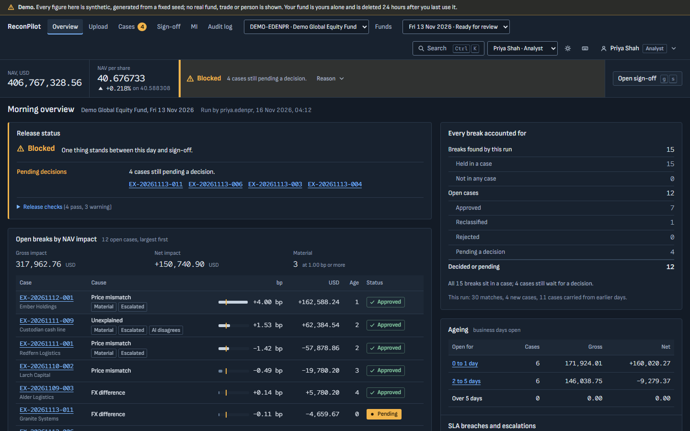
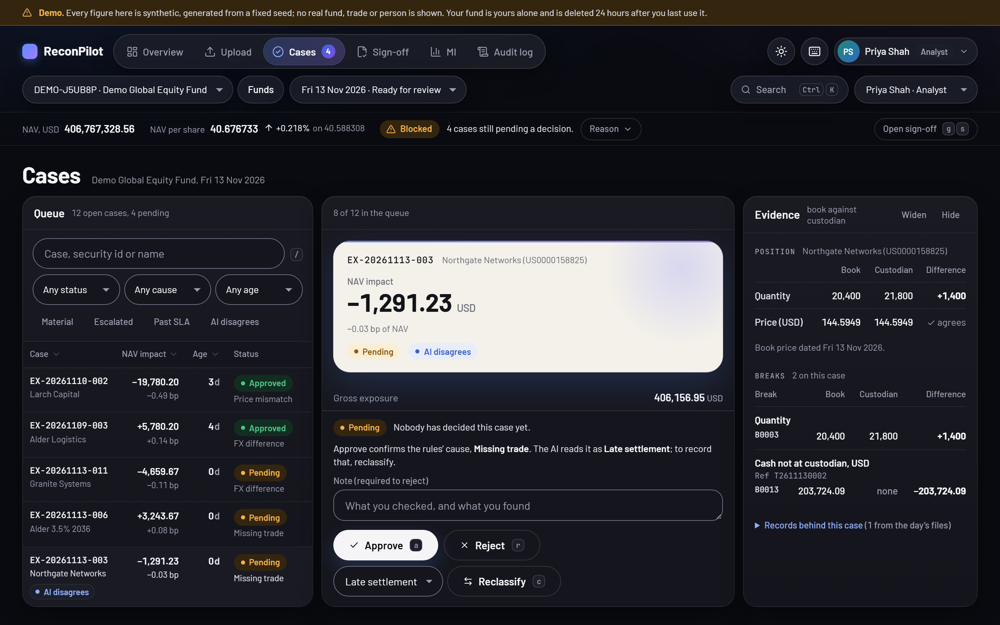
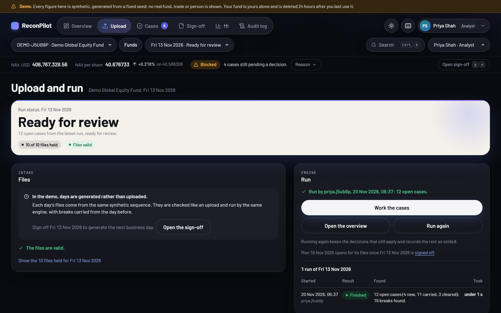
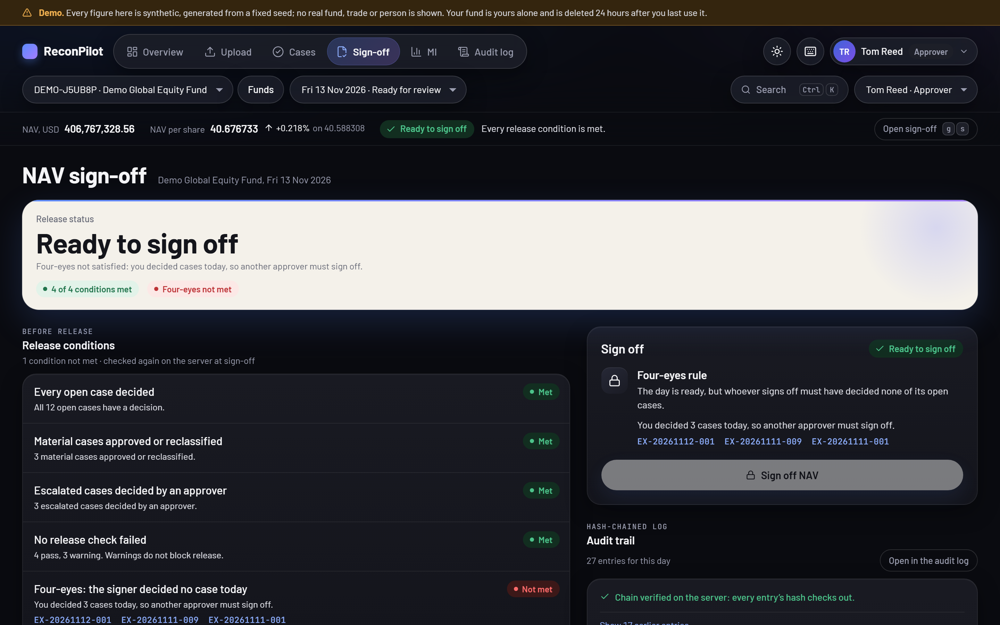

# ReconPilot

AI-assisted break triage and investigation for fund reconciliation, sitting on
top of a deterministic, auditable matching engine.

Every business day a fund administrator compares three records: the fund's own
trades and positions, the custodian's holdings statement, and the custodian's
cash statement. Anything that does not agree is a break. Breaks have to be
found, explained, chased with the custodian and signed off before the NAV goes
out. ReconPilot runs that loop end to end. A rules engine finds the breaks;
a language model reads the evidence for each one and suggests the cause, explains
it with the actual figures, lists the investigation steps and drafts the query
to the custodian. An analyst approves every suggestion before anything happens.

It comes two ways: a command line that runs a fund's day into a folder and an
Excel report, and a [web application](#web-application) for a team, with
roles, a PostgreSQL system of record, four-eyes sign-off and a verifiable audit
log, which anyone can [try as a demo](#the-public-demo).



## Who does what

| Step | Done by | Why |
|---|---|---|
| Match positions and cash, apply tolerances | Deterministic engine | Must be exact, repeatable and explainable to an auditor |
| Calculate NAV with fee accruals, run release checks | Deterministic engine | Figures that go to clients cannot depend on a model |
| Size each case's NAV impact, flag material ones | Deterministic engine | Prioritisation must be explainable and repeatable |
| Age open cases, escalate, track SLAs, clear on later matches | Deterministic engine | The multi-day workflow is a control, not a judgement |
| Suggest the cause of each break | Rules **and** AI | The AI reads the narrative text and context the rules cannot weigh |
| Explain the break, plan the investigation, draft the query | AI (rules as fallback) | Writing this up is where analysts spend their time |
| Approve, reject or reclassify; sign off the day | People | Accountability stays with the team |
| Record every action and every AI call | Hash-chained audit log | Tamper-evident trail for audit and model risk |

The AI never touches a figure, never raises or closes a case and never changes
the NAV. It only explains, suggests and drafts. That keeps the numbers exactly
reproducible while the slow, judgement-heavy part of the job gets faster.

## AI-assisted triage

For each case the engine assembles the evidence: the breaks with book and
custodian figures, the security, the related trades, settled and pending
custodian cash lines with their narrative text, pre-computed differences and
ratios, and the rule-based suggestion. The model returns structured JSON:

```json
{
  "category": "TIMING",
  "confidence": 0.9,
  "explanation": "Trade T2611130041 for 1,900 units was due to settle on 2026-11-13 ...",
  "investigation_steps": ["Check the custodian's failed-trades report ...", "..."],
  "custodian_query": "Subject: Unsettled trade T2611130041 ..."
}
```

Before anyone sees it, the response passes four guardrails:

1. **Schema.** It must match a strict JSON schema, and the category must be one
   of the existing causes. Anything else is rejected.
2. **No invented figures.** Every number in the explanation must trace back to
   the evidence the model was given (rounding allowed). A single unsupported
   figure rejects the whole response.
3. **Disagreement is surfaced, not resolved.** If the model disagrees with the
   rules, both suggestions are kept and the case is flagged
   *"AI disagrees: needs review"*.
4. **Safe fallback.** On any error, timeout, invalid response or missing API
   key, the case keeps its rule-based output and the run carries on.

Every call is written to the audit log with the model, a hash of the prompt,
the raw response and whether the fallback was used. Responses are cached on disk
by prompt hash, so evaluation runs are reproducible and cost nothing to repeat.

Anthropic, OpenAI and Google models are supported through their HTTP APIs, with
no SDK dependencies, and so is a private OpenAI-compatible endpoint (such as a
firm's own Azure OpenAI deployment) set by `OPENAI_COMPATIBLE_BASE_URL`.

## Results

The data generator plants known breaks and writes an answer key, so the whole
pipeline can be scored. Over 20 business days with 200 planted breaks on the
**hard** data set (seed 42, medium reasoning effort):

| | Rules only | AI (gpt-6-luna) | AI (gemini-3.8-flash) |
|---|---|---|---|
| Breaks detected | 190/200 (95.0%) | 190/200 (95.0%) | 190/200 (95.0%) |
| Correct cause (of detected) | 178/190 (93.7%) | 190/190 (100.0%) | 190/190 (100.0%) |
| False alarms | 8/198 (4.0%) | 8/198 (4.0%) | 8/198 (4.0%) |
| Correct: late settlement (TIMING) | 21/33 | 33/33 | 33/33 |
| AI responses accepted by guardrails | n/a | 198/198 | 198/198 |
| Disagreed with rules (AI right / rules right) | n/a | 12 (12 / 0) | 12 (12 / 0) |

What this does and does not show:

- **Detection and false alarms are identical by design.** The AI explains the
  cases the engine raises; it does not find new ones.
- **All 12 gains are late settlements the custodian did not report as
  pending.** The rules read these as missing trades; both models read the trade
  and settlement dates and called them late. The prompt's definition of a
  timing break explicitly covers an unreported settlement, so part of the gain
  comes from that definition. In real life an unreported trade can genuinely be
  missing, which is why every disagreement goes to an analyst.
- **The 8 false alarms are dividends posted with no security identifier.** Both
  models correctly labelled all 8 as dividends where the rules said UNKNOWN,
  but the scorer matches cases to planted breaks by security, so they still
  count against both. Tying the payment to the right holding needs information
  the custodian did not send.
- The rules and the generator were written together, and the data is
  synthetic, so these are measures of consistency on known patterns, not of
  accuracy on real statements. On the standard data set the rules alone score
  100% on every measure.

Over 20 consecutive business days on the same hard data, with every open case
re-assessed each day (`reconpilot evaluate --multi-day --hard --ai`):

| | Rules only | AI (gpt-6-luna) |
|---|---|---|
| Detected on the day they appeared | 190/200 (95.0%) | 190/200 (95.0%) |
| Cause right on the first day | 178/190 (93.7%) | 189/190 (99.5%) |
| Cleared automatically on the fix day | 160/167 (95.8%) | 160/167 (95.8%) |
| Cause right at resolution | 157/160 (98.1%) | 160/160 (100.0%) |
| AI responses accepted by guardrails | n/a | 597/598 |

Cases carried from one day to the next keep the trade they came from, so the
AI is as accurate on them as on new ones: on an 8-day hard run (seed 21) it
named the right cause on 44/44 new and 75/75 carried cases, against the rules'
41/44 and 74/75, and every disagreement with the rules was flagged for review
(`scripts/ai_carried_check.py`).

Full tables and confusion matrices: [docs/evaluation.md](docs/evaluation.md).

## The deterministic engine

- **Matching.** Positions are compared on quantity and price. Cash is matched
  in passes, strictest first: exact reference and amount, reference within
  tolerance, security and amount when the reference is blank, and many-to-one
  when the custodian nets several trades into one line.
- **Rule-based triage.** Breaks on the same security form one case. Rules
  suggest a cause with a confidence score, explanation and draft query; this is
  also the fallback whenever the AI is unavailable.
- **NAV and release checks.** Stale prices, missing prices, NAV movement against
  a threshold, and a cash tie-out showing how much of the gap open breaks
  explain.
- **Review and sign-off.** Analysts approve, reject (with a reason) or
  reclassify each case. Only an approver can sign off the day, and not one who
  reviewed any case (four-eyes rule). Viewers can read but not act.
- **Audit log.** Each entry carries the SHA-256 hash of the one before, so an
  edited, deleted or reordered line is detected by `reconpilot verify-audit`.
- **Excel exception report.** Summary, exceptions with both the rule-based and
  AI suggestions side by side, raw breaks, cash matching, NAV checks and MI.

## The operations workflow across days

A reconciliation is not finished when the day's report is printed; breaks are
worked over days until they clear. Point `run` at the same `--out` folder every
day and ReconPilot keeps the fund's history there.

- **NAV impact and materiality.** Every case gets its net effect on NAV if the
  custodian's view is right (position market value plus cash), its size in
  basis points of NAV and its gross exposure. The queue and the report are
  sorted by impact. Cases at or above the materiality threshold (default 1 bp,
  `--materiality-bp`) are material: they block NAV release until approved or
  reclassified.
- **Carried items and automatic clearing.** Cash items left unmatched are fed
  back into the next day's matching, so a late settlement that arrives today
  matches yesterday's book item. A case whose breaks have gone is cleared
  automatically, with an audit entry. A booked trade the custodian settles late
  is recorded as resolved as a late settlement, whatever it looked like on day
  one.
- **Ageing, escalation and SLAs.** Open cases keep their identifier and age in
  business days, bucketed 0-1, 2-5 and >5. Material cases, and cases open
  longer than `--escalate-after` days (default 5), are escalated with an audit
  entry and need an approver's decision before sign-off. Cases open longer
  than their SLA (`--sla-material` 2 days, `--sla-other` 5 days) are reported
  as breaches.
- **Pricing controls.** The book-versus-custodian price tolerance is set per
  asset class (equities 25 bp, bonds 10 bp), and a day-on-day check flags
  prices that moved more than 10% (equities) or 2% (bonds) since the prior
  day, which catches bad prices and corporate actions applied on one side.
- **Accruals.** The NAV accrues the management fee (on the prior NAV) and
  other expenses daily, covering weekends on Mondays, and a release check
  fails on a missed accrual.
- **Management information.** An MI sheet in the report shows open breaks by
  cause and age with their NAV impact, average days to resolve, the top five
  cases by impact, SLA breaches and the trend over recent days. Each run also
  writes `mi.csv` in tidy long form (`as_of, metric, cause, age_bucket, value`)
  for Tableau or any other BI tool.

The multi-day evaluation runs one fund for 20 consecutive business days with
10 new breaks a day, each fixed 1 to 6 days later, and checks that every case
clears on the day the data agrees again:

| | Standard data | Hard data |
|---|---|---|
| Detected on the day they appeared | 200/200 (100.0%) | 190/200 (95.0%) |
| Cause right on the first day | 200/200 (100.0%) | 178/190 (93.7%) |
| Cleared automatically on the fix day | 169/169 (100.0%) | 160/167 (95.8%) |
| Cleared before the data was fixed | 0 | 0 |
| Cause right at resolution | 169/169 (100.0%) | 157/160 (98.1%) |
| Average business days to resolve | 3.17 | 3.16 |

On hard data, a third of the late settlements look like missing trades on the
day they appear (the custodian reports nothing pending). When they settle, the
case clears and is recorded as a late settlement, so all 30 are right at
resolution: the same weakness the AI fixes on day one, fixed instead by time.
The 7 breaks that do not clear on their fix day are dividends posted with no
security identifier, which are grouped together and clear only when all of
them have been booked.

No real data is used anywhere. All funds, securities and statements are
generated.

## Quick start

Requires Python 3.10+.

```bash
python -m venv .venv
source .venv/bin/activate        # Windows: .venv\Scripts\activate
pip install -e ".[dev]"
```

Run a sample day on the rules alone:

```bash
reconpilot demo --dir demo
```

Run a working week, with breaks that age, escalate and clear:

```bash
reconpilot demo --dir demo-week --days 5
```

```
2026-11-13: 34 cash matches, 15 breaks, 11 open cases (4 new), 4 cleared automatically
  cleared EX-20261112-007  US0000806780   PRICE_MISMATCH  after 1 business day(s)
  cleared EX-20261109-002  GB0000678257   MISSING_TRADE   after 4 business day(s)
  ...
Review queue, largest NAV impact first (M material, E escalated, S SLA breached):
 ME  EX-20261111-002  US0000075627       383,603.04   +8.52bp  age  2  PENDING      PRICE_MISMATCH  0.85
 MES EX-20261110-004  US0000344774      -276,346.20   -6.14bp  age  3  PENDING      PRICE_MISMATCH  0.85
     EX-20261110-007  US0000353195        41,888.14   +0.93bp  age  3  PENDING      DIVIDEND        0.90
  ...
  [PASS] Day-on-day price moves
  [PASS] Accruals
  [FAIL] NAV release
```

Run it with AI-assisted triage. Set one key; the first one found is used, in the
order Anthropic, OpenAI, Google:

```bash
export ANTHROPIC_API_KEY=...     # or OPENAI_API_KEY / GOOGLE_API_KEY
reconpilot demo --dir demo --hard --ai
```

```
AI triage: openai / gpt-6-luna (effort medium)
2026-11-13: 30 cash matches, 18 breaks, 12 open cases (12 new), 0 cleared automatically
  ...
     EX-20261113-011  (none)               2,841.57   +0.06bp  age  0  PENDING      UNKNOWN         0.30   AI: DIVIDEND 0.96  [AI disagrees: needs review]
     EX-20261113-004  JP0000512651        -1,728.45   -0.04bp  age  0  PENDING      MISSING_TRADE   0.70   AI: TIMING 0.84  [AI disagrees: needs review]
     EX-20261113-009  GB0000482048           -97.09   -0.00bp  age  0  PENDING      UNKNOWN         0.30   AI: FX_DIFFERENCE 0.96  [AI disagrees: needs review]
     EX-20261113-007  US0000275807            -0.03   -0.00bp  age  0  PENDING      STOCK_SPLIT     0.95   AI: STOCK_SPLIT 0.95
```

AI options, accepted by `run`, `demo` and `evaluate`:

| Option | Default |
|---|---|
| `--ai` | off: without it, or without a key, everything runs on the rules alone |
| `--ai-provider` | first of `anthropic`, `openai`, `google` with a key set; `openai_compatible` for a private endpoint |
| `--ai-model` | `claude-sonnet-5-5`, `gpt-6-luna` or `gemini-3.8-flash` |
| `--ai-effort` | `medium` (reasoning effort, where the provider supports it) |
| `--ai-cache` | `.reconpilot_cache/ai` |

## The daily workflow

```bash
# 1. Generate a week of data, one folder per business day (or use your own CSVs)
reconpilot generate --as-of 2026-11-09 --days 5 --breaks 4 --out data --hard

# 2. Each morning: reconcile into the fund's run folder, roll cases forward,
#    get the AI's second opinion, value the fund, write the report and mi.csv
reconpilot run --data data/2026-11-09 --out runs/fund1 --user priya --ai

# 3. Work the queue, largest NAV impact first
reconpilot queue --run runs/fund1
reconpilot review --run runs/fund1 --user priya --case EX-20261109-002 --approve
reconpilot review --run runs/fund1 --user priya --case EX-20261109-004 \
    --reclassify TIMING --note "custodian confirms failed delivery, settles T+1"

# ...or in bulk from a CSV with columns case_id,decision,category,note
reconpilot review --run runs/fund1 --user priya --decisions decisions.csv

# 4. Escalated (material or aged) cases need an approver's decision
reconpilot review --run runs/fund1 --user ann --role approver --case EX-20261109-001 --approve

# 5. A different approver releases the NAV
reconpilot signoff --run runs/fund1 --user tom --role approver

# 6. Check nobody has edited the audit trail (including the AI calls)
reconpilot verify-audit --run runs/fund1

# Next morning: same --out, and yesterday's cases carry over
reconpilot run --data data/2026-11-10 --out runs/fund1 --user priya --ai

# Score rules against AI, and the multi-day lifecycle
reconpilot evaluate --hard --ai
reconpilot evaluate --multi-day --hard
```

## Web application

The web application puts the same engine in front of a fund-servicing team.
Each morning the team loads the day's files, sees every break ranked by its
effect on the NAV, reads the rules' and the AI's view of each one side by side,
decides them with maker-checker controls, and releases the NAV under the
four-eyes rule, with management information and a hash-chained audit log that
anyone can verify. It is a FastAPI service over PostgreSQL, with a worker for
the day's runs and a React front end in `web/`. Every figure on every screen
comes from the API; the browser holds no figure of its own, and every control
it shows is enforced again on the server.



<table>
<tr>
<td width="50%"></td>
<td width="50%"></td>
</tr>
<tr>
<td></td>
<td></td>
</tr>
<tr>
<td></td>
<td></td>
</tr>
</table>

The screenshots are of the running application on the public demo's synthetic
data (`npm run screenshots` in `web/` takes them again; see
[Tests](#tests-for-the-web-application)).

### A day in the browser

| Screen | Keys | What it is for |
|---|---|---|
| **Overview** | `g o` | The release status and its reasons, every break accounted for (found, held in a case, decided, pending), open breaks by NAV impact (gross and net, never net alone), ageing, escalations, what cleared, the trend |
| **Upload and run** | `g u` | The day's files, checked file by file and row by row before anything runs; the run's progress; the day's runs |
| **Cases** | `g q` | The workbench: queue, case and evidence panes, the AI's second opinion, the drafted custodian query, the decision bar |
| **Sign-off** | `g s` | The release conditions in plain words, who decided what, the day's audit trail, and the sign-off itself |
| **MI** | `g m` | Breaks by cause and age, time to resolve, the trend, the largest open breaks, SLA breaches; Excel and `mi.csv` exports |
| **Audit log** | `g l` | The whole hash-chained log, filtered, verified on the server and exported |
| **Funds** | `g f` | Every fund and its latest day, and the chosen fund's settings |
| **Administration** | | Administrators only, from the user menu or the palette: users, and each fund's settings, calendar and AI switch |

A whole day is worked in the browser, in the same order as on the command line:
**Upload** the day's files (several at once; each expected file shown as held
or missing with what the checks found, and every problem by file and row,
before anything runs), run the day and follow its progress, with the day's
runs listed beneath; read the **Overview** (release status and its reasons, every
break accounted for, open breaks by NAV impact, ageing, escalations, what
cleared); work the **Cases** queue (approve, reject with a note, reclassify;
escalated cases need an approver); and **Sign-off**, where a second approver
releases the NAV and the day locks. Days go strictly in order, so the next
business day can be uploaded only once the previous one is signed off; the
upload screen says so in plain words before anyone tries, and leads to the day
that is holding things up.

Several funds are worked side by side. The fund selector in the top bar
switches between them and remembers each user's choice on the server, so it
follows them to another browser; **Funds** (`g f`) lists every fund with its
latest day and shows the chosen fund's settings read-only: materiality,
escalation and SLA days, the AI second opinion, the release checks in force
and the business calendar.

**MI** (`g m`) is the management information for the fund up to the day on
show, computed by the engine's own MI from every run day's cases: open breaks
by cause and age with their gross and net NAV impact, the trend across run days
(open, new, cleared, material, escalated and past SLA), the average business
days to resolve by cause, the five largest open breaks and every SLA breach.
Two buttons export the day's **exception report** (the engine's Excel workbook,
MI sheet included) and **mi.csv** in the engine's tidy form for a BI tool; both
are the files the command line writes for the same days, and every download is
recorded in the audit log with the file's SHA-256.

The **Audit log** (`g l`) is the whole hash-chained log, newest first, for the
fund being worked or for every fund with the system's own entries (sign-ins,
new users and funds). It filters by business day, by when an entry was
recorded, by who, by action and by case, all kept in the address so a view can
be shared, and pages through a long history without losing its place. Each
entry opens to its full record: the payload, both hashes and the server's check
that its hash recomputes and that it names the entry before it. **Verify
chain** re-checks every hash on the server and names the first entry that does
not fit if the log has been altered; the check is itself recorded. **Export
CSV** downloads the matching entries in chain order with their stored payloads
and hashes, so anyone can recompute every hash with `reconpilot.audit.record_hash`
and re-verify an unfiltered export end to end; the download is audited like the
others. The sign-off screen's audit trail opens the same day in the log.

History runs across days. A case in the workbench shows **Across days**: its
status, cause, age, impact and flags at the end of every day it was run, from
the day it was first seen to the day it cleared, each earlier day opening the
case as it stood then. The overview's trend gives each run day's open impact,
gross above net, and opens any earlier day.

### Running it

Nothing needs Docker: development uses an embedded PostgreSQL started from
Python, and Node 20.19 or later for the front end.

```bash
pip install -e ".[dev,web]"
(cd web && npm install)
reconpilot-web dev
```

`reconpilot-web dev` starts the embedded database in `.rp_data/` (or uses
`RP_DATABASE_URL`), brings the schema up to date and, the first time, creates
the fund `DEMO1` (first business day 2026-11-09) and four users, printing
their one-time passwords once:

```
Created fund DEMO1 starting 2026-11-09 and these users. The passwords are shown once only; note them now:
  analyst1   analyst          ********************
  approver1  approver  admin  ********************
  approver2  approver         ********************
  viewer1    viewer           ********************
API on http://127.0.0.1:8000/api with a worker running in-process.
Front end on http://localhost:5173 (Vite, proxying /api to the API).
Ctrl+C stops everything.
```

It then serves the API on `127.0.0.1:8000` with a worker running in the same
process and, once `npm install` has been run in `web/`, Vite's dev server on
`localhost:5173`, which proxies `/api` to the API; open that address and sign
in. Ctrl+C stops the API, the worker, Vite and the database. For a single
server, build the front end once (`npm run build` in `web/`) and
`reconpilot-web serve` serves it from `web/dist` beside the API.

To work a day, generate some files and upload one day's folder on **Upload**
as `analyst1`:

```bash
reconpilot generate --as-of 2026-11-09 --days 2 --breaks 4 --hard --out data
```

### The public demo

The demo is a separate instance with a database of its own, so demo and real
data never meet: a database records its mode when it is first migrated, and an
instance refuses to start against one of the other mode.

```bash
(cd web && npm run build)          # the front end the demo serves
reconpilot-web serve --mode demo   # API, front end, worker and expiry cleanup in one process
```

With no `RP_DATABASE_URL` it runs on its own embedded database in
`.rp_data/demo/` (never the development one beside it); on a host, point
`RP_DATABASE_URL` at any PostgreSQL 15 or later. One Python process and
PostgreSQL host the whole demo: on start it migrates (recording demo mode),
loads the AI cache, and runs the API serving the built front end, a worker and
the cleanup job. Behind a proxy, set uvicorn's `FORWARDED_ALLOW_IPS` so the
rate limit sees each visitor's own address.

The sign-in page offers **Try the demo** instead of a password, under a notice
that every figure is synthetic, which stays on every screen. One click makes
the visitor a fund of their own by running the engine's sequence generator from
a fixed seed (seed 62, a hard-mode working week from Monday 9 November 2026,
four new breaks a day). The week's files go through the same validation and
runs as an upload; Monday to Thursday are then worked by the fund's own sandbox
users through the real decision and sign-off code (the analyst decides the
cases, one approver the escalated ones, the other signs off), and Friday waits
for the visitor. The fund has four one-click users with no password, Priya Shah
(analyst), Ann Lee and Tom Reed (approvers, to show four-eyes) and Vic Moss
(viewer), and **Working as** in the top bar switches between them. Each is a
real session checked by the server like any other, and sees its own fund and
nothing else: other visitors' funds, cases, jobs and audit entries answer 404.
Uploads are switched off on the server; instead, once the latest day is signed
off, **Generate** on the upload screen loads the next business day of the same
sequence (to Friday 20 November) and runs it, with Friday's breaks carried in.

The AI's second opinions come from a cache, so the demo needs no API key and
costs nothing to run: `src/reconpilot_web/demo_ai_cache.json` holds the real
AI's responses (and nothing else) for every case of the sequence's ten days,
and a visitor's fund never calls a provider; anything not cached falls back to
the rules. `scripts/build_demo_ai_cache.py` rebuilds it by running the real AI
through the web application's own code on a throwaway database, so the prompts
match a visitor's exactly, and then checks that a fund built from the cache
alone finds every answer (102 questions, all cached; the AI disagreed with the
rules 29 times). A test fails if a change to the engine's prompts leaves any
question unanswered, which is the cue to rebuild it:

```bash
source keys.env   # OPENAI_API_KEY, never committed
python scripts/build_demo_ai_cache.py --provider openai
```

The browser keeps a cookie (its token stored only as a hash) so a visitor whose
session has ended, or who signed out, can **carry on** with their own fund from
the sign-in page for as long as it lives. A visitor's fund expires 24 hours
after it was last used: every request moves the expiry on, and the cleanup job deletes expired funds with their days, cases,
decisions, users and sessions every ten minutes (their audit entries stay, as
the log is append-only). Starting a demo is limited to five an hour per address
and the number of live demo funds is capped at 200, both configurable.

The demo's browser journey is a recruiter's two-minute visit: try the demo,
read the AI's opinion and the draft query on the top case, decide the pending
cases, switch to an approver for the escalated ones and be stopped by
four-eyes, switch to the other approver to sign off, generate and run the next
day, read as the viewer and verify the audit chain, and check that a second
visitor gets a fund of their own and cannot reach the first. It runs on its own
throwaway demo server (`scripts/e2e_server.py serve-demo`, port 8766):

```bash
cd web
npm run test:e2e:demo
```

### Roles and controls

| Role | May |
|---|---|
| **Analyst** | Load and run days; approve, reject (with a note) or reclassify cases (on an escalated case the decision is recorded, but only an approver's clears the escalation) |
| **Approver** | Everything an analyst may, plus clear escalated cases with their decision and sign off the NAV |
| **Viewer** | Read every screen, MI and the audit log, and export; decide nothing |
| **Admin** (a flag on any account) | Administer users and funds, switch a fund's AI on or off, and ask to unlock a signed-off day |

Every control is enforced on the server, from the session's role, whatever the
browser shows; the front end only hides what the server would refuse.

- **Viewers cannot act.** Every change is refused for a viewer.
- **A rejection needs a note**, so the reason is on record.
- **Escalated cases need an approver.** Material cases, and cases open longer
  than the fund's escalation days, are escalated by the engine; only an
  approver's decision counts for them. The escalation records the NAV impact at
  the time, labelled "at escalation" so it is not mistaken for today's.
- **Material cases block release** until they are approved or reclassified.
- **Four-eyes sign-off.** Whoever signs off must not have decided any of the
  day's open cases, so `approver2` signs off the cases `approver1` decided.
- **One release status.** *Ready* or *Blocked*, with every reason (pending
  decisions, material cases awaiting approval, escalated cases awaiting an
  approver, failed checks, four-eyes), is computed on the server and shown
  identically in the NAV strip, on the overview and at sign-off. The engine's
  own check, which covers material cases only, appears under its accurate name,
  "Material cases approved".
- **Sign-off locks the day**: its files, cases and decisions can no longer
  change.
- **Days go in order.** A day must be signed off before the next business day
  can be uploaded or run, so only the latest day can be run again. A re-run
  keeps the decisions that still apply and voids the rest with an audit entry;
  a case the new run no longer raises is withdrawn, also audited.
- **Stale decisions are refused.** Each decision carries the case's version;
  if someone else decided first, the second decision is refused, never written
  over theirs, and the workbench names who decided and shows their decision,
  keeping the note in case it is still wanted.
- **Unlocking takes two people** (see [Administration](#administration)).
- **Everything is in the audit log**: sign-ins and failures, lockouts, uploads,
  validation, runs, decisions, sign-offs, exports, every AI call, and user and
  fund changes.

### The AI and its guardrails

The web application uses the engine's AI exactly as the command line does: a
second opinion beside the rules for each case, with an explanation that quotes
the evidence, investigation steps and a drafted custodian query (with a copy
button) in the workbench. The four guardrails in
[AI-assisted triage](#ai-assisted-triage) apply unchanged: a strict schema,
no figure that is not in the evidence, disagreement surfaced as *"AI disagrees:
needs review"* rather than resolved, and a fallback to the rules on any error,
timeout, invalid answer or missing key. The AI never decides anything: every
decision is a person's, through the decision bar. Every call is in the audit
log with the model, a hash of the prompt and the raw response, and responses
are cached in PostgreSQL.

- **Off until an administrator switches it on.** In real mode the AI is off
  for every fund. Switching it on is per fund, names the provider, and needs
  the administrator to acknowledge where the evidence goes (to a public
  provider it leaves the firm; to a private endpoint it goes to the host
  shown). `AI_SWITCHED_ON` and `AI_SWITCHED_OFF` record who, the provider and
  the model.
- **Providers.** Anthropic, OpenAI and Google through their HTTP APIs, or a
  **private endpoint**: any OpenAI-compatible service, such as a bank's own
  Azure OpenAI deployment, set by `OPENAI_COMPATIBLE_BASE_URL` with
  `OPENAI_COMPATIBLE_API_KEY`, `OPENAI_COMPATIBLE_MODEL`,
  `OPENAI_COMPATIBLE_API_VERSION` and `OPENAI_COMPATIBLE_AUTH` (`bearer` or
  `api-key`). A provider can be chosen only when the server has its key (or,
  for the private endpoint, its address).
- **Keys stay on the server.** They are read from the environment, never
  stored in the database, never sent to the browser and never shown.
- **The demo never calls a provider**: its answers come from a pre-filled
  cache (see [The public demo](#the-public-demo)).

### Administration

**Administration** (in the user menu, or "Open administration" in the
palette) is for accounts with the admin flag, checked on the server for every
request, and has two tabs, **Users** and **Funds**. Demo users and demo funds
are never administered, as they come and go with their visitor.

- **Users.** Create an account (the password policy applies: at least 12
  characters, not a common password), change its display name, role or admin
  flag, deactivate and reactivate it, reset its password, and unlock an
  account locked after five failed sign-ins. A change of role, admin flag or
  password, and a deactivation, end every live session of that user at once.
  No administrator can change their own account, so the last administrator can
  never lock everyone out. Each change is one audit entry.
- **Funds.** Create a fund, rename it, and change its settings (materiality,
  escalation and SLA days, the release checks) and its non-business dates.
  Settings apply from the fund's next run; a non-business date can be added or
  removed only after the fund's latest loaded day, so the calendar a day was
  worked on never changes under it. Audited setting by setting.
- **The AI switch** per fund, on the Funds tab, with its warning about where
  the evidence goes, as above.
- **Unlocking a signed-off day**, on the sign-off screen of that day.
  Occasionally a released day has to be
  reopened (a price corrected after release, a decision recorded against the
  wrong cause). An **administrator asks**, with a reason; a **different
  approver confirms** within 24 hours, or declines with a note; the requester
  may withdraw, and an unconfirmed request expires. Only the fund's latest
  signed-off day can be unlocked, and only before the next business day has
  run (after that, its cases were carried from this sign-off); both are checked
  when asking and again when confirming. Confirming returns the day to *ready*:
  the sign-off is cleared, the cases can be decided again, and the day must be
  signed off again, under four-eyes, before the next day can be loaded or run.
  The files, the run and every decision stand, and the audit log keeps the
  original sign-off beside `UNLOCK_REQUESTED` and `DAY_UNLOCKED`.

### Keyboard and accessibility

The desk works from the keyboard. **Ctrl+K** (Cmd+K on a Mac), or **Search**
in the top bar, opens the command palette: type part of a case id, a security,
a screen, a fund or a day and press Enter to go there, or run an action. The
palette offers only what the person may do now, by role and by the day's
state (the server still checks every request): approve, reject or reclassify
the open case on the workbench, run the day on upload, verify the chain or
export on the audit log, the two exports on MI, the theme, sign out, and in
the demo "Work as" another user. "Sign off the NAV…" opens the same
confirmation as the button and never signs off by itself. The shortcuts:

| Keys | Does |
|---|---|
| `g` then `o` `u` `q` `s` `m` `l` (`f`) | Overview, upload, cases, sign-off, MI, audit log (funds) |
| `j` `k`, arrows, `Enter` | Move through the queue and open the case |
| `a` `r` `c` | Approve, reject (to the note), reclassify (to the cause) |
| `/` | Search the queue; on the audit log, filter by case |
| `Ctrl+K` | The command palette, even from inside a field |
| `?` | Every shortcut on the screen in view |
| `Esc` | Leave a field, or close the dialog |

Shortcuts never fire while you type. Motion only explains a change: figures
ease to a new value, the release status pulses once when it moves from
blocked to ready, rows arrive in the queue, panes swap in under 200 ms; all
of it is off when the system asks for reduced motion.

The application aims at WCAG 2.2 AA in both themes, and the browser tests hold
it to that:

- **Checked on every screen.** axe runs on every screen and state the journeys
  reach (sign-in, each screen with and without data, the dialogs, the palette,
  the demo), in the dark and the light theme, and fails on any serious or
  critical violation.
- **Keyboard only.** One journey works a whole business day without the
  mouse: sign in, load and run the day, approve, reject with a note and
  reclassify, decide the escalated cases as an approver, sign off through the
  confirmation dialog as a second approver, and load and run the next day.
- **Focus goes where the person is.** Moving to a screen puts focus on its
  title and names it in the browser tab; dialogs take focus, hold it, and give
  it back on Esc; after signing off, focus moves to the result, as the button
  that was pressed has gone; a failed sign-in puts focus on the reason.
- **Results are read out.** A run starting and finishing, and each decision
  recorded, are announced through one polite live region that is always in
  the page; failures are alerts.
- **Status never by colour alone.** Every status, check and flag pairs an icon
  with a word, and the day being viewed in a trend chart is picked out by a
  mark beneath its bar (on the overview) or its figures in bold (on MI) as
  well as by colour. Flags are labels, not tiny buttons.
- **200% zoom.** Every screen works in a 720 by 450 window (a 1440 by 900
  screen at 200%): nothing runs off the side, wide tables scroll inside their
  own frame, the NAV strip stops sticking in so short a window so it never
  covers the work, and axe still passes.
- Semantic tables with captions, labelled controls, a skip link, and a light
  theme (from the system's setting or the theme button) beside the dark
  default.

### Architecture

```
browser ──► front end (Vite in development; built files served by the API in production)
               │ /api  (session cookie, CSRF token on every change)
               ▼
            api (FastAPI) ──────────────┐
               │ enqueue                 │ read/write
               ▼                         ▼
            worker ─────────────────► PostgreSQL
               │ calls
               ▼
            reconpilot engine ── AI provider (server-side key, or a private endpoint)
```

- **The engine stays the core.** `src/reconpilot/` is a library the web layer
  calls; it never imports the web layer. The API stores the day's files with
  their SHA-256, builds the engine's `DayData`, calls `pipeline.run_day` with
  the fund's settings, and persists the results in one transaction. A test
  runs the same multi-day files through the command line and through the web
  pipeline and requires identical cases, figures and audit actions.
- **PostgreSQL is the system of record**: funds and their calendars, business
  days, the original input files, cases (current state as columns, the
  engine's full case as JSONB), each case as it stood at the end of every day,
  breaks and carried items, decisions, the audit log, jobs and the AI cache,
  under Alembic migrations. Development uses an embedded PostgreSQL started
  from Python (`pgserver`); production uses any PostgreSQL 15 or later.
- **Runs are jobs.** A small job table and a worker that claims jobs with
  `FOR UPDATE SKIP LOCKED`, so two workers never take the same one; failures
  are retried with back-off and recorded. The front end polls the job for
  progress.
- **The audit log is append-only by permission.** The engine's own record
  format and SHA-256 chain, written through a database implementation of its
  `append`, so the engine's review and AI code write to it unchanged. Appends
  are serialised so the chain cannot fork; the application's database role
  (`rp_app`) can only insert into and read it, and a trigger rejects UPDATE,
  DELETE and TRUNCATE.
- **Security.** argon2id passwords with a common-password check; an account
  locks for 15 minutes after five failed sign-ins; session ids stored only as
  hashes, in httpOnly, SameSite=Lax cookies (Secure behind HTTPS) with a
  30-minute idle and 12-hour absolute timeout; a CSRF token on every change;
  authorisation on every route, with tests per role; a strict
  Content-Security-Policy and security headers; uploads limited to 5 MB and
  200,000 rows a file and parsed defensively; SQL only with bound parameters;
  secrets only from the environment.
- **Demo and real data never meet.** A database records its mode (`real` or
  `demo`) when first migrated, and an instance refuses to start against one of
  the other mode.
- **Front end.** React and TypeScript on Vite, TanStack Query for the API and
  TanStack Table for the tables, Radix UI primitives for the dialogs, menus and
  popovers, and CSS custom properties for the Night desk palette: deep slate,
  a blue accent, and one amber signal colour for whatever needs someone.

### The API

Everything the screens do goes through the API, so the same day can be worked
from a script. With the files generated as above:

```python
from pathlib import Path

import httpx

def sign_in(user, password):
    c = httpx.Client(base_url="http://127.0.0.1:8000")
    c.post("/api/auth/login", json={"username": user, "password": password}).raise_for_status()
    c.headers["X-CSRF-Token"] = c.cookies["rp_csrf"]  # required on every POST
    return c

analyst = sign_in("analyst1", "<password printed by dev>")
approver = sign_in("approver1", "<password printed by dev>")
signer = sign_in("approver2", "<password printed by dev>")      # four-eyes: decides nothing
fund, day = "DEMO1", "2026-11-09"

files = [("files", (p.name, p.read_bytes(), "text/csv")) for p in Path(f"data/{day}").glob("*.csv")]
analyst.post(f"/api/funds/{fund}/days/{day}/files", files=files).json()   # {'status': 'validated', ...}
job = analyst.post(f"/api/funds/{fund}/days/{day}/run").json()["job_id"]   # 202: queued for the worker
analyst.get(f"/api/jobs/{job}").json()["status"]                         # 'done' a moment later

for case in analyst.get(f"/api/funds/{fund}/days/{day}/cases").json():   # largest NAV impact first
    who = approver if case["escalated"] else analyst                     # escalated cases need an approver
    who.post(f"/api/funds/{fund}/cases/{case['case_id']}/decision",
             json={"decision": "approve", "version": case["version"]})

signer.get(f"/api/funds/{fund}/days/{day}/release?for_user=me").json()  # ready, reasons, signable_by_me
signer.post(f"/api/funds/{fund}/days/{day}/signoff").json()["status"]  # 'signed_off'
signer.get(f"/api/funds/{fund}/days/{day}/audit").json()["chain_ok"]   # the day's audit trail: True

analyst.get(f"/api/funds/{fund}/days/{day}/runs").json()["runs"]          # the day's runs, newest first
analyst.get(f"/api/funds/{fund}/days/2026-11-10/intake").json()["open"]   # True once the day before is signed off
analyst.put("/api/auth/me/preferences", json={"fund": fund}).json()     # the fund this user works

analyst.get(f"/api/funds/{fund}/days/{day}/mi").json()["by_cause_age"]   # MI: open breaks by cause and age
Path("report.xlsx").write_bytes(analyst.get(f"/api/funds/{fund}/days/{day}/exports/report.xlsx").content)
Path("mi.csv").write_bytes(analyst.get(f"/api/funds/{fund}/days/{day}/exports/mi.csv").content)  # both audited

analyst.get("/api/audit", params={"fund": fund, "action": "CASE_APPROVED"}).json()["entries"]  # newest first
analyst.get("/api/audit/entries/1").json()["hash_ok"]                    # one entry, checked on the server
analyst.post("/api/audit/verify").json()                                # {'chain_ok': True, 'broken_at': None, ...}
Path("audit.csv").write_bytes(analyst.get("/api/audit/export.csv", params={"fund": fund}).content)  # audited
case_id = analyst.get(f"/api/funds/{fund}/days/{day}/cases").json()[0]["case_id"]
analyst.get(f"/api/funds/{fund}/cases/{case_id}").json()["days"]         # the case at the end of each day
```

Whoever signs off must not have decided any of the day's open cases, so
`approver2` signs off the cases `approver1` decided. A viewer can read
everything and decide nothing.

Administration and unlocking have their own routes, all checked on the server
(the admin flag for `/api/admin`, the roles above for unlocking):

| Route | Does |
|---|---|
| `GET`, `POST /api/admin/users`; `PATCH /api/admin/users/{username}` | List and create users; change name, role or admin flag, deactivate or reactivate |
| `POST /api/admin/users/{username}/password`, `.../unlock` | Reset a password; unlock a locked account |
| `POST /api/admin/funds`; `GET`, `PATCH /api/admin/funds/{code}` | Create a fund; read and change its name, settings and calendar |
| `GET /api/admin/ai/providers`; `PUT /api/admin/funds/{code}/ai` | Which providers the server can use; switch a fund's AI on (with a provider and the acknowledgement) or off |
| `GET`, `POST /api/funds/{code}/days/{as_of}/unlock` | A day's unlock requests; ask to unlock it, with a reason (administrator) |
| `POST .../unlock/{id}/confirm`, `.../decline` | Confirm (a different approver); decline (an approver, with a note) or withdraw (the requester) |

### Commands and settings

| Command | What it does |
|---|---|
| `reconpilot-web dev [--host --port --start-date]` | Everything for development, as above |
| `reconpilot-web serve [--host --port]` | The API, and the built front end from `web/dist` when it exists |
| `reconpilot-web serve --mode demo` | The public demo in one process (see below) |
| `reconpilot-web demo-cleanup` | Delete demo funds unused for 24 hours (the demo server also does this itself) |
| `reconpilot-web worker [--once]` | Run queued day runs (retried up to three times) |
| `reconpilot-web migrate` | Create or upgrade the schema and record the instance mode |
| `reconpilot-web create-user --username --role [--admin]` | Add an account (password from `RP_NEW_PASSWORD` or a prompt) |
| `reconpilot-web create-fund --code --name --start-date` | Add a fund with the engine's default settings |

| Variable | Meaning |
|---|---|
| `RP_DATABASE_URL` | PostgreSQL 15+ for the API and worker; empty means the embedded database |
| `RP_MIGRATION_DATABASE_URL` | The schema owner for `migrate` (default `RP_DATABASE_URL`) |
| `RP_MODE` | `real` (default) or `demo`; a database is written for one mode only |
| `RP_DATA_DIR` | Local state: the embedded database and AI cache (default `.rp_data`) |
| `RP_COOKIE_SECURE` | `1` behind HTTPS |
| `ANTHROPIC_API_KEY`, `OPENAI_API_KEY`, `GOOGLE_API_KEY` | Public AI providers' keys, used only for funds with AI switched on (never by the demo) |
| `RP_AI_PROVIDER` | The server's default provider (else the first with a key set) |
| `RP_AI_MODEL`, `RP_AI_EFFORT`, `RP_AI_TIMEOUT` | The default provider's model, the reasoning effort (default `medium`) and the timeout in seconds (default 120) |
| `OPENAI_COMPATIBLE_BASE_URL` and its companions | A private OpenAI-compatible endpoint: `_API_KEY`, `_MODEL`, `_API_VERSION`, `_AUTH` (`bearer` or `api-key`) |
| `RP_DEMO_MAX_FUNDS` | Demo: the most visitor funds alive at once (default 200) |
| `RP_DEMO_CREATIONS_PER_HOUR` | Demo: how many demos one address may start in an hour (default 5) |

`reconpilot-web migrate` creates an application role, `rp_app`, that can only
insert into and read the audit log; production runs the API and worker as that
role and migrations as the owner.


### Tests for the web application

The web layer's tests run with the engine's (`pytest`), against an embedded
PostgreSQL the tests start themselves: roles on every route, fund access,
sign-off order, four-eyes, material blocking, release status, locking, stale
decisions, the append-only audit log, chain verification, validation, demo
isolation, administration and unlocking, and the equivalence with the command
line.

Front-end checks, run in `web/`: `npm run typecheck`, `npm run lint` and
`npm test -- --run` (Vitest with Testing Library).

Browser tests (Playwright, Chromium) walk whole business days against the real
API, worker and built front end on a throwaway embedded database, and run axe
on every screen in the dark and light themes:

```bash
cd web
npx playwright install chromium   # once
npm run test:e2e                   # builds web/dist, then runs the journeys
```

`scripts/e2e_server.py` starts that server: it wipes its data folder (the
system temp folder's `reconpilot-e2e` unless `RP_E2E_DATA_DIR` says otherwise),
creates the funds `E2E1` and `E2E2` and the four users with a test password, generates two
business days and serves on port 8765. The journeys: first, sign-in (and a
failed attempt), a page that does not exist and the shortcuts dialog pass axe,
and focus follows the person from screen to screen and in and out of the
dialog. Then the analyst uploads and
runs the first day, opens a case from the overview and works the queue; an
approver decides the escalated case and is then kept from signing off by the
four-eyes rule; a second approver signs off; the analyst uploads and runs the
next day, with the open cases carried into it; a viewer reads every screen and
can act on none. On the second fund: the analyst reads every fund's settings,
switches fund and finds the choice again in a new session; loads the first
day's files in two goes, seeing per file what is missing; runs the day and sees
it in the day's runs; and is told in plain words that the next day waits for
the first day's sign-off, which the server confirms. Then a viewer opens MI,
switches the trend's measure, downloads both exports and finds the downloads
in the day's audit trail. On the first fund's two days, the analyst
follows a carried case across days and opens it as it stood the day before,
and a viewer filters the audit log to one case's approval, opens the entry with
the server's check of it, verifies the chain and exports the log as CSV. The
second fund's day is then worked from the keyboard alone, with no mouse click
anywhere: an analyst loads and runs it, hearing the run finish, and approves,
rejects with a note and reclassifies; an approver decides the escalated cases;
a second approver signs off through the confirmation dialog (focus held inside
it, given back on Esc, then moved to the result); and the next day is loaded
and run. The palette journey jumps to a case and between screens. Last, every
screen is opened at 200% zoom and checked for sideways scrolling, room for the
work under the sticky bars, and axe in both themes.

The screenshots in this README are taken from the running demo by a journey of
their own, which is skipped unless asked for:

```bash
cd web
npm run screenshots                # builds web/dist, starts a demo server, writes docs/images/*.png
```

## Input files

| File | Contents |
|---|---|
| `book_trades.csv` | Fund's trades: id, dates, security, side, quantity, price, currency, FX rate, fees, settlement cash |
| `book_positions.csv` | Fund's positions with price and price date |
| `custodian_holdings.csv` | Custodian's holdings statement |
| `custodian_cash.csv` | Custodian's cash statement in base currency, with narrative, including lines value-dated in the future |
| `securities.csv`, `fx_rates.csv`, `fund.csv` | Static data with asset class, rates, opening cash, prior NAV, shares in issue, fee rate and expense budget |
| `book_cash.csv` | Non-trade cash booked by the fund: income, FX adjustments (optional) |
| `accruals.csv` | Fee and expense accruals booked for the day (optional) |
| `prior_prices.csv` | Book prices on the prior business day, for the price move check (optional) |
| `planted_breaks.json` | Answer key (generated data only), with start and fix dates in multi-day data |

A run folder holds `run.json`, the hash-chained `audit.jsonl`, today's
`cases.json`, one `exceptions_<date>.xlsx` per day, `mi.csv`, and
`state/<date>/` with each day's case ledger and carried open items.

## Project layout

```
src/reconpilot/
  ai.py          AI triage: evidence, prompt, providers, guardrails, cache
  generator.py   synthetic days with planted breaks
  sequence.py    consecutive days for one fund, with breaks that persist until fixed
  matching.py    position and cash matching, per-asset-class tolerances, carried items
  triage.py      grouping breaks into cases, rule-based causes, draft queries
  impact.py      NAV impact, materiality and the NAV release check
  ledger.py      cases across days: ageing, escalation, SLAs, auto-clearing
  pipeline.py    one business day through the whole pipeline
  nav.py         NAV with accruals, release checks, price move and accrual checks
  mi.py          management information and the tidy mi.csv
  review.py      approve / reject / reclassify, roles, four-eyes sign-off
  audit.py       hash-chained audit log
  report.py      Excel exception report
  evaluate.py    scoring against the answer key, rules versus AI
  storage.py     CSV and JSON reading and writing
  cli.py         command line
src/reconpilot_web/
  app.py         FastAPI application: security headers, CSRF on every change
  auth.py        accounts, sessions, roles and lockout
  funds.py       funds, settings and the business calendar
  days.py        upload, validation and day status; queuing runs
  validation.py  file checks before any run
  jobs.py        PostgreSQL job queue and worker
  runner.py      a day through the engine, persisted in one transaction
  cases.py       case queue, detail and decisions
  release.py     release status and four-eyes sign-off
  overview.py    the morning overview
  mi.py          MI across days and the audited Excel and mi.csv exports
  auditviewer.py the audit log viewer: filters, pages, chain check and CSV export
  auditlog.py    the hash-chained audit log in PostgreSQL
  aicache.py     the AI response cache in PostgreSQL, and the demo's cache-only client
  admin.py       administration: users, funds and each fund's AI switch
  unlock.py      unlocking a signed-off day: an administrator asks, another approver confirms
  demo.py        demo mode: visitor funds from the generator, one-click users, next day, expiry
  demo_ai_cache.json  the demo's AI responses, built by scripts/build_demo_ai_cache.py
  cli.py         reconpilot-web: dev, serve, worker, migrate, create-user, create-fund, demo-cleanup
scripts/         the common-password list generator, the AI carried-case check, the demo's AI cache
                 builder and the browser-test server
tests/           unit and end-to-end tests; AI tests use a fake client, no network
tests/web/       the web layer against an embedded PostgreSQL, including CLI equivalence
web/src/         the front end: shell and NAV strip, command palette, upload and run, overview, cases,
                 sign-off, MI, audit log, funds, admin
web/e2e/         browser journeys (Playwright): every screen with axe in both themes, a keyboard-only day,
                 200% zoom; e2e/demo/ the demo's journey and the README's screenshots
docs/            the evaluation, the design and plans, the mockups, and the screenshots in docs/images/
```

Run the tests with `pytest`. No API key is needed.

## Limitations and next steps

- One base currency (USD), and on the command line one fund per run folder
  (the web application works several funds side by side). Bonds are priced
  per unit, with no accrued interest, and there are no multi-currency cash
  accounts.
- Cases are tracked across days by security, so two unrelated breaks on the
  same security share one case, and payments with no security identifier are
  pooled into a single case.
- NAV impact assumes the custodian's view is right. When the book is right,
  the impact is the same size with the opposite sign, which is why it is used
  for ranking and materiality, not as a correction.
- In the multi-day simulation the book writes off the custodian's few-cent
  rounding each day; a live fund would post those write-offs explicitly.
- The AI sees one case at a time. It cannot attach an unidentified payment to a
  holding when the custodian sends nothing to link them.
- The evaluation is on synthetic data the rules were designed alongside, with
  200 breaks; 100% on 190 detected cases is a strong result on known patterns,
  not a claim about production accuracy.
- The figure check stops invented numbers in the explanation, not wrong
  reasoning about correct numbers. That is what the human review is for.
- Sending evidence to an external model is a data-governance decision. Here the
  data is synthetic; a real deployment would need an approved provider or a
  privately hosted model.
- Cases are matched to the answer key by security, so a break spanning two
  securities would be scored as two.

- With `--ai`, open cases are re-assessed every day, and a carried case whose
  evidence changes costs a new call (598 calls over the 20-day evaluation).

The web application is a working system, not a deployable product for a
regulated firm:

- **Built-in accounts only.** There is no single sign-on; `users` keeps a
  nullable `external_subject` so it can be added without reworking roles.
- **No hosting kit.** `reconpilot-web serve` is one process serving the API,
  the built front end and a worker; HTTPS, backups, monitoring and the
  database's own security are left to whoever hosts it.
- **Not a regulated-grade deployment.** No high availability, point-in-time
  recovery or log shipping. The audit chain shows any edited, deleted or
  reordered entry, and the application's own database role cannot change it,
  but the database's owner could drop the trigger and rewrite the whole chain
  consistently; anchoring the latest hash outside the database would close
  that.
- **Files, not feeds.** The day's statements are uploaded as CSV files; there
  are no live custodian feeds (SWIFT MT535 and MT950, ISO 20022 camt.053).
- **Lockout, not rate limits.** Sign-in is protected by locking an account
  after five failures; only starting a demo is rate-limited per address, so
  sign-in, runs and exports have no per-address limit yet.
- **A desk tool.** It is laid out for a desk screen (and works at 200% zoom on
  one), not for a phone.
- **The demo's AI is a cache** built from one seed; a question it does not
  hold falls back to the rules, and a private endpoint has not been measured
  against the evaluation.

Future work: single sign-on; a production hosting kit with HTTPS and backups;
regulated-grade deployment (high availability, point-in-time recovery, log
shipping, an external anchor for the audit chain); live custodian feeds; AI
extraction of corporate-action notices checked against the custodian;
per-currency cash accounts; and measuring analyst time per case with and
without the AI's write-up.

## Licence

MIT
