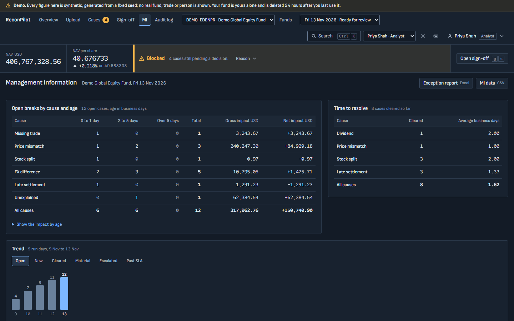
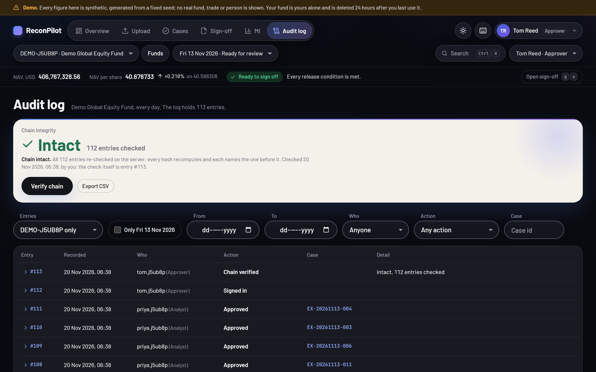
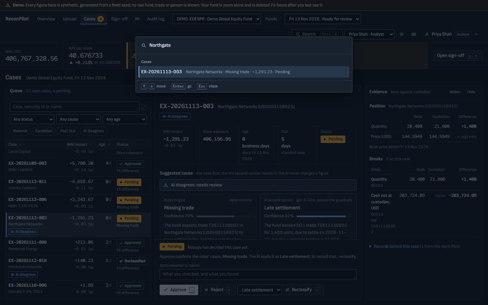
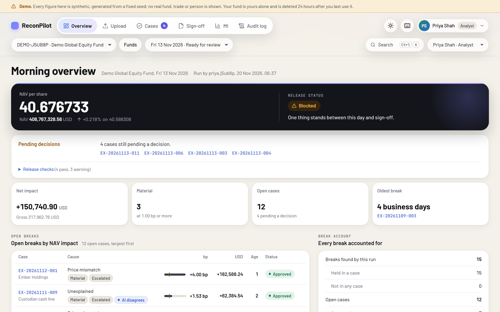
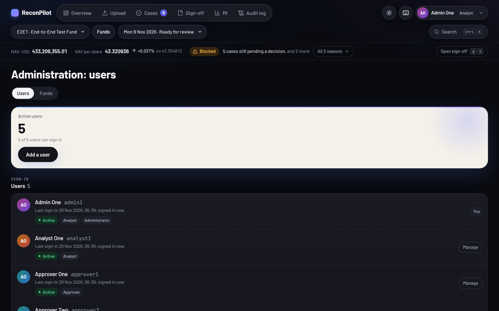

# ReconPilot

A fund reconciliation and NAV-checking engine, with a web application for the
team that works the breaks.

Every business day a fund administrator compares three records: the fund's own
trades and positions, the custodian's holdings statement and the custodian's
cash statement. Anything that does not agree is a break. Breaks have to be
found, sized against the NAV, explained, chased with the custodian and signed
off before the NAV goes out. ReconPilot runs that loop end to end.
Deterministic rules find, group, size and age every break; an optional AI
second opinion sits beside the rules and explains each case with the actual
figures, plans the investigation and drafts the query to the custodian. People
decide every case, and a second approver releases the NAV under the four-eyes
rule. Every step lands in a hash-chained audit log that anyone can verify.

It comes two ways: a command line that runs a fund's day into a folder and an
Excel exception report, and a web application (FastAPI, PostgreSQL, React) for a
team, with roles, maker-checker controls and a one-click demo.

**Read more:** [Technical overview](docs/technical-overview.md) (architecture,
controls, data integrity, the AI's guardrails, security, testing, trade-offs) ·
[Evaluation](docs/evaluation.md) · [Design system](docs/design/paper-adaptation.md)


## Why I built this

I want to work in fund-servicing operations, and I wanted to show rather than
say that I understand the job: what a break is, why a late settlement looks
like a missing trade on day one, why materiality is measured in basis points of
NAV, why the person who signs off must not be the person who decided the
cases, and why an auditor cares that nobody can quietly edit yesterday's log.
So I built the tool I would want on the desk each morning, and I built it the
way a control function would expect: the figures come from deterministic,
repeatable code; every control is enforced on the server, not in the browser;
and the AI is there to save an analyst time on the write-up, never to decide
anything or change a number.

The data is synthetic throughout. The generator plants known breaks and writes
an answer key, which let me measure the rules and the AI honestly rather than
by eye.

## At a glance

| | |
|---|---|
| **Engine** | Position and cash matching with per-asset-class tolerances, rule-based triage into cases, NAV with fee accruals, release checks, NAV impact and materiality in bp, ageing, escalation, SLAs and automatic clearing across days, MI, an Excel report |
| **Web application** | Seven screens for the daily cycle (overview, upload and run, case workbench, sign-off, MI, audit log, funds) plus administration; several funds side by side; history across days |
| **Controls** | Four-eyes sign-off, days strictly in order, sign-off locks the day, two-person unlock, stale-decision protection, one release status with its reasons, an append-only audit chain enforced in the database |
| **AI second opinion** | Rules first, the AI beside them; strict schema, no figure that is not in the evidence, disagreement flagged for review, fallback to the rules; off per fund until an administrator switches it on; private endpoint option |
| **Stack** | Python 3.10+, FastAPI, SQLAlchemy 2, Alembic, PostgreSQL (embedded via `pgserver` for local work, no Docker), a Postgres job queue with `FOR UPDATE SKIP LOCKED`; React 19, TypeScript, Vite, TanStack Query and Table, Radix UI |
| **Tests** | 404 Python tests (120 engine, 284 web layer against a real PostgreSQL), 24 Vitest files, 25 Playwright journeys with axe in both themes, plus the demo's own journey |

## Who does what

| Step | Done by | Why |
|---|---|---|
| Match positions and cash, apply tolerances | Deterministic engine | Must be exact, repeatable and explainable to an auditor |
| Calculate NAV with fee accruals, run release checks | Deterministic engine | Figures that go to clients cannot depend on a model |
| Size each case's NAV impact, flag material ones | Deterministic engine | Prioritisation must be explainable and repeatable |
| Age open cases, escalate, track SLAs, clear on later matches | Deterministic engine | The multi-day workflow is a control, not a judgement |
| Suggest the cause of each break | Rules **and** AI | The AI reads the narrative text and context the rules cannot weigh |
| Explain the break, plan the investigation, draft the query | AI (rules as fallback) | Writing this up is where analysts spend their time |
| Approve, reject or reclassify; sign off the day | People | Accountability stays with the team |
| Record every action and every AI call | Hash-chained audit log | Tamper-evident trail for audit and model risk |

The AI never touches a figure, never raises or closes a case and never changes
the NAV. It only explains, suggests and drafts.

## Quick start

Requires Python 3.10+, and Node 20.19+ for the web front end. Nothing needs
Docker.

```bash
python -m venv .venv
source .venv/bin/activate        # Windows: .venv\Scripts\activate
pip install -e ".[dev,web]"
```

### The command line

Run a sample day on the rules alone, or a working week with breaks that age,
escalate and clear:

```bash
reconpilot demo --dir demo
reconpilot demo --dir demo-week --days 5
```

```
2026-11-13: 34 cash matches, 15 breaks, 11 open cases (4 new), 4 cleared automatically
  cleared EX-20261112-007  US0000806780   PRICE_MISMATCH  after 1 business day(s)
  cleared EX-20261109-002  GB0000678257   MISSING_TRADE   after 4 business day(s)
  ...
Review queue, largest NAV impact first (M material, E escalated, S SLA breached):
 ME  EX-20261111-002  US0000075627       383,603.04   +8.52bp  age  2  PENDING      PRICE_MISMATCH  0.85
 MES EX-20261110-004  US0000344774      -276,346.20   -6.14bp  age  3  PENDING      PRICE_MISMATCH  0.85
     EX-20261110-007  US0000353195        41,888.14   +0.93bp  age  3  PENDING      DIVIDEND        0.90
  ...
  [PASS] Day-on-day price moves
  [PASS] Accruals
  [FAIL] NAV release
```

With the AI's second opinion (set one key; the first found is used, in the
order Anthropic, OpenAI, Google):

```bash
export ANTHROPIC_API_KEY=...     # or OPENAI_API_KEY / GOOGLE_API_KEY
reconpilot demo --dir demo --hard --ai
```

```
AI triage: openai / gpt-6-luna (effort medium)
     EX-20261113-011  (none)               2,841.57   +0.06bp  age  0  PENDING      UNKNOWN         0.30   AI: DIVIDEND 0.96  [AI disagrees: needs review]
     EX-20261113-004  JP0000512651        -1,728.45   -0.04bp  age  0  PENDING      MISSING_TRADE   0.70   AI: TIMING 0.84  [AI disagrees: needs review]
     EX-20261113-007  US0000275807            -0.03   -0.00bp  age  0  PENDING      STOCK_SPLIT     0.95   AI: STOCK_SPLIT 0.95
```

### The web application

```bash
(cd web && npm install)
reconpilot-web dev
```

`reconpilot-web dev` starts an embedded PostgreSQL in `.rp_data/` (or uses
`RP_DATABASE_URL`), brings the schema up to date and, the first time, creates
the fund `DEMO1` (first business day 2026-11-09) and four users, printing their
one-time passwords once:

```
Created fund DEMO1 starting 2026-11-09 and these users. The passwords are shown once only; note them now:
  analyst1   analyst          ********************
  approver1  approver  admin  ********************
  approver2  approver         ********************
  viewer1    viewer           ********************
API on http://127.0.0.1:8000/api with a worker running in-process.
Front end on http://localhost:5173 (Vite, proxying /api to the API).
Ctrl+C stops everything.
```

Open `http://localhost:5173`, sign in as `analyst1`, and upload one day's
folder on **Upload**:

```bash
reconpilot generate --as-of 2026-11-09 --days 2 --breaks 4 --hard --out data
```

For a single server, build the front end once (`npm run build` in `web/`) and
`reconpilot-web serve` serves it from `web/dist` beside the API.

### The demo

```bash
(cd web && npm run build)
reconpilot-web serve --mode demo   # API, front end, worker and expiry clean-up in one process
```

The sign-in page offers **Try the demo**. One click gives the visitor a fund of
their own, a hard-mode working week with Monday to Thursday already worked and
signed off and Friday waiting, and four one-click users to switch between. It
needs no API key: the AI's answers come from a pre-built cache. See
[Demo mode](#demo-mode).

## The web application

The same engine in front of a fund-servicing team. Each morning the team loads
the day's files, sees every break ranked by its effect on the NAV, reads the
rules' and the AI's view of each one side by side, decides them under
maker-checker controls and releases the NAV under the four-eyes rule. Every
figure on every screen comes from the API; the browser holds no figure of its
own, and every control it shows is enforced again on the server.


<table>
<tr>
<td width="50%"></td>
<td width="50%"></td>
</tr>
<tr>
<td></td>
<td></td>
</tr>
<tr>
<td></td>
<td></td>
</tr>
</table>

The screenshots are of the running application on the demo's synthetic data;
`npm run screenshots` in `web/` takes them again.

### The screens

| Screen | Keys | Lead card | What it is for |
|---|---|---|---|
| **Overview** | `g o` | NAV per share and the release status | Four tiles (net impact, material, open cases, oldest break), the open breaks by NAV impact (gross and net, never net alone), every break accounted for, ageing and SLA, escalations, what cleared, the trend |
| **Upload and run** | `g u` | The day's run status | The day's files checked file by file and row by row before anything runs, the run's progress, the day's runs |
| **Cases** | `g q` | The selected case's NAV impact and status | The workbench: the queue, the rules beside the AI, the evidence, the drafted custodian query, the case across days, the decision bar |
| **Sign-off** | `g s` | The release status and four-eyes | The conditions as Met or Not met, who decided what, the day's audit trail, the sign-off itself |
| **MI** | `g m` | Gross open NAV impact across the period | Breaks by cause and age, time to resolve, the trend, the largest open breaks, SLA breaches; Excel and `mi.csv` exports |
| **Audit log** | `g l` | Chain integrity | The whole hash-chained log, filtered, each entry checked, verified on the server and exported |
| **Funds** | `g f` | The number of funds | Every fund with its latest day, and the chosen fund's settings |
| **Administration** | palette | Active users, or funds | Administrators only: users, and each fund's settings, calendar and AI switch |

A day is worked in the browser in the same order as on the command line:
upload and run, read the overview, work the queue, sign off. Days go strictly
in order, so the next business day can be uploaded only once the previous one
is signed off; the upload screen says so in plain words before anyone tries.
A case's **Across days** shows how it stood at the end of every day it was
run, from the day it was first seen to the day it cleared.

### The look: Paper

I adapted Paper, a design system first written for a phone app, to a dense,
keyboard-driven desktop tool
([`docs/design/paper-adaptation.md`](docs/design/paper-adaptation.md)):

- **Midnight by default**, a layered cool dark; **Paper**, a warm light theme,
  on the theme button and remembered.
- **One lead card per screen**, full width and first, in strong contrast, for
  the one figure that matters there; everything else is calm cards, hairline
  rows and right-aligned tabular figures.
- **Status always with a word.** Every status is a pill with a dot and a word
  (Pending, Approved, Blocked, Intact, *AI disagrees*), never colour alone.
- Barlow for text and figures, JetBrains Mono for codes (case ids, ISINs,
  trade references), Lucide icons, and self-hosted fonts so the strict CSP
  holds.
- The screens sit in a glass capsule in the top bar; below 768 px wide it
  floats at the foot of the window.
- Motion only explains a change (the lead figure counts up when a day loads,
  the release status pulses once when it turns ready, a toast confirms each
  decision), and all of it is off under reduced motion.

### Keyboard and command palette

**Ctrl+K** (Cmd+K on a Mac), or **Search** in the top bar, opens the command
palette: type part of a case id, a security, a screen, a fund or a day and
press Enter to go there, or run an action. It offers only what the person may
do now, by role and by the day's state (the server still checks every
request). "Sign off the NAV…" opens the same confirmation as the button and
never signs off by itself.

| Keys | Does |
|---|---|
| `g` then `o` `u` `q` `s` `m` `l` `f` | Overview, upload, cases, sign-off, MI, audit log, funds |
| `j` `k`, arrows, `Enter` | Move through the queue and open the case |
| `a` `r` `c` | Approve, reject (to the note), reclassify (to the cause) |
| `/` | Search the queue; on the audit log, filter by case |
| `Ctrl+K` | The command palette, even from inside a field |
| `?` | Every shortcut on the screen in view |
| `Esc` | Leave a field, or close the dialog |

Shortcuts never fire while you type.

### Roles and controls

| Role | May |
|---|---|
| **Analyst** | Load and run days; approve, reject (with a note) or reclassify cases (on an escalated case the decision is recorded, but only an approver's clears the escalation) |
| **Approver** | Everything an analyst may, plus clear escalated cases and sign off the NAV |
| **Viewer** | Read every screen, MI and the audit log, and export; decide nothing |
| **Admin** (a flag on any account) | Administer users and funds, switch a fund's AI on or off, and ask to unlock a signed-off day |

Every control is enforced on the server from the session's role; the front end
only hides what the server would refuse.

- **Four-eyes sign-off.** Whoever signs off must not have decided any of the
  day's open cases.
- **One release status.** *Ready* or *Blocked*, with every reason (pending
  decisions, material cases awaiting approval, escalated cases awaiting an
  approver, failed checks, four-eyes), computed on the server and shown
  identically in the NAV strip, on the overview and at sign-off.
- **Materiality.** Cases at or above the fund's threshold in basis points of
  NAV (default 1 bp) block release until approved or reclassified.
- **Escalation and SLAs.** Material cases, and cases open longer than the
  fund's escalation days, need an approver's decision; cases past their SLA are
  reported as breaches.
- **Sign-off locks the day**, and **days go in order**: day N+1 cannot be
  uploaded or run until day N is signed off.
- **Stale decisions are refused.** Each decision quotes the case's version; if
  someone else decided first, the second is refused, never written over theirs.
- **Unlocking takes two people.** An administrator asks with a reason and a
  different approver confirms within 24 hours; only the latest signed-off day,
  and only before the next day has run.
- **Everything is in the audit log**: sign-ins and failures, lockouts,
  uploads, validation, runs, decisions, sign-offs, exports, every AI call, and
  user and fund changes. The application's database role can only insert into
  and read it, and a trigger rejects any update, delete or truncate.

### The AI second opinion

For each case the engine assembles the evidence (the breaks with book and
custodian figures, the related trades, settled and pending cash lines with
their narrative, pre-computed differences, the rules' suggestion) and the model
returns strict JSON: a cause, a confidence, an explanation, investigation steps
and a draft custodian query. Before anyone sees it:

1. **Schema.** It must match a strict JSON schema, and the cause must be one of
   the existing ones.
2. **No invented figures.** Every number in the explanation must trace back to
   the evidence (rounding allowed); one unsupported figure rejects the answer.
3. **Disagreement is surfaced, not resolved.** If the AI disagrees with the
   rules, both are kept and the case is flagged *"AI disagrees: needs review"*.
4. **Safe fallback.** On any error, timeout, invalid answer or missing key, the
   case keeps the rules' output and the run carries on.

Every call is in the audit log with the model, a hash of the prompt and the raw
response; answers are cached by prompt hash. In the web application the AI is
**off for every fund** until an administrator switches it on, naming the
provider and acknowledging where the evidence goes. Anthropic, OpenAI and
Google are supported over plain HTTP, and so is a **private OpenAI-compatible
endpoint** (such as a firm's own Azure OpenAI deployment) set by
`OPENAI_COMPATIBLE_BASE_URL`. Keys stay on the server, read from the
environment, and are never stored or sent to the browser.

### Demo mode

The demo is a separate instance with a database of its own: a database records
its mode when first migrated, and an instance refuses to start against one of
the other mode, so demo and real data never meet.

- **A fund per visitor**, built by the engine's sequence generator from a
  fixed seed and run through the same validation, runs, decisions and
  sign-offs as a real day. **Generate** loads and runs the next business day
  once the latest is signed off.
- **Four one-click users**: Priya Shah (analyst), Ann Lee and Tom Reed
  (approvers, to show four-eyes) and Vic Moss (viewer), switched with
  **Working as** in the top bar. Each is a real server session that sees its
  own fund and nothing else; another visitor's fund answers 404.
- **Cached AI.** `src/reconpilot_web/demo_ai_cache.json` holds the real AI's
  answers for every question the demo's sequence asks (102), so a visitor's
  fund never calls a provider; anything not cached falls back to the rules.
- **Bounded.** Uploads are off on the server, a visitor's fund expires 24 hours
  after last use, starting a demo is limited per address (five an hour) and
  live demo funds are capped (200), both configurable. A notice that every
  figure is synthetic stays on every screen.

### Administration

**Administration** (the user menu, or "Open administration" in the palette)
is for accounts with the admin flag, checked on the server.



- **Users**: create (at least 12 characters, not a common password), change
  name, role or admin flag, deactivate, reset a password, unlock a locked
  account. A change of role, admin flag or password ends that user's live
  sessions at once. No administrator can change their own account.
- **Funds**: create, rename, change settings (materiality, escalation and SLA
  days, release checks) and non-business dates. Settings apply from the next
  run; the calendar can change only after the fund's latest loaded day.
- **The AI switch** per fund, with its warning about where the evidence goes.
- **Unlocking a signed-off day** from that day's sign-off screen, as above.

## Results

The generator plants known breaks and writes an answer key, so the whole
pipeline can be scored. Over 20 business days with 200 planted breaks on the
**hard** data set (seed 42, medium reasoning effort):

| | Rules only | AI (gpt-6-luna) | AI (gemini-3.8-flash) |
|---|---|---|---|
| Breaks detected | 190/200 (95.0%) | 190/200 (95.0%) | 190/200 (95.0%) |
| Correct cause (of detected) | 178/190 (93.7%) | 190/190 (100.0%) | 190/190 (100.0%) |
| False alarms | 8/198 (4.0%) | 8/198 (4.0%) | 8/198 (4.0%) |
| AI answers accepted by the guardrails | n/a | 198/198 | 198/198 |
| Disagreed with rules (AI right / rules right) | n/a | 12 (12 / 0) | 12 (12 / 0) |

- **Detection and false alarms are identical by design.** The AI explains the
  cases the engine raises; it does not find new ones.
- **All 12 gains are late settlements the custodian did not report as
  pending.** The rules read these as missing trades; both models read the trade
  and settlement dates. Part of that gain comes from the prompt's definition of
  a timing break, and in real life an unreported trade can genuinely be
  missing, which is why every disagreement goes to an analyst.
- **The 8 false alarms are dividends posted with no security identifier**,
  which the scorer cannot tie to a planted break.
- The data is synthetic and the rules and generator were written together, so
  these are measures of consistency on known patterns, not of accuracy on real
  statements.

Over 20 consecutive business days (`reconpilot evaluate --multi-day --hard
--ai`) the AI named the right cause on the first day for 189/190 detected
breaks against the rules' 178/190, and at resolution for 160/160 against
157/160; 597 of 598 answers passed the guardrails. Cases carried into later
days keep their original trade, so the AI is as accurate on them as on new
ones (75/75 carried, 44/44 new on an 8-day run), with every disagreement
flagged. Full tables and confusion matrices are in
[docs/evaluation.md](docs/evaluation.md).

## The engine and the daily workflow

- **Matching.** Positions on quantity and price, with the price tolerance per
  asset class (equities 25 bp, bonds 10 bp). Cash in passes, strictest first:
  exact reference and amount, reference within tolerance, security and amount
  when the reference is blank, and many-to-one when the custodian nets trades.
- **Triage.** Breaks on the same security form one case; rules suggest a cause
  with a confidence, an explanation and a draft query.
- **NAV and release checks.** Stale and missing prices, NAV movement, a cash
  tie-out, day-on-day price moves (10% equities, 2% bonds) and missed accruals;
  the management fee accrues on the prior NAV, weekends included on Mondays.
- **NAV impact.** Each case's net effect on NAV if the custodian is right, in
  USD and basis points, with its gross exposure. Queues are sorted by it.
- **Across days.** Unmatched cash items are carried into the next day's
  matching, so a late settlement matches yesterday's book item; a case whose
  breaks have gone clears automatically with an audit entry. Open cases age in
  business days (0-1, 2-5, >5), escalate and are checked against their SLA.
- **MI.** Open breaks by cause and age with their NAV impact, days to resolve,
  the top five, SLA breaches and the trend, in the Excel report and as a tidy
  `mi.csv` for a BI tool.

```bash
reconpilot generate --as-of 2026-11-09 --days 5 --breaks 4 --out data --hard
reconpilot run --data data/2026-11-09 --out runs/fund1 --user priya --ai
reconpilot queue --run runs/fund1
reconpilot review --run runs/fund1 --user priya --case EX-20261109-002 --approve
reconpilot review --run runs/fund1 --user priya --case EX-20261109-004 \
    --reclassify TIMING --note "custodian confirms failed delivery, settles T+1"
reconpilot review --run runs/fund1 --user priya --decisions decisions.csv   # bulk
reconpilot review --run runs/fund1 --user ann --role approver --case EX-20261109-001 --approve
reconpilot signoff --run runs/fund1 --user tom --role approver              # a different approver
reconpilot verify-audit --run runs/fund1
reconpilot run --data data/2026-11-10 --out runs/fund1 --user priya --ai    # next day: cases carry over
reconpilot evaluate --hard --ai
reconpilot evaluate --multi-day --hard
```

AI options for `run`, `demo` and `evaluate`: `--ai` (off without it, or without
a key), `--ai-provider` (`anthropic`, `openai`, `google`, or
`openai_compatible` for a private endpoint), `--ai-model`, `--ai-effort`
(default `medium`) and `--ai-cache` (default `.reconpilot_cache/ai`).

## Tests

```bash
pytest                                   # engine and web layer; the web tests start their own embedded PostgreSQL
cd web
npm run typecheck && npm run lint
npm test -- --run                        # Vitest and Testing Library
npx playwright install chromium          # once
npm run test:e2e                         # browser journeys with axe, keyboard-only and 200% zoom
npm run test:e2e:demo                    # the demo's journey on its own demo server
```

No API key is needed: the AI tests use a fake client. The web tests include an
**equivalence test** that runs five days of the same files through the command
line and through the web pipeline and requires identical cases, NAV, checks,
audit actions, MI, Excel cells and a byte-for-byte identical `mi.csv`. The
browser suite works whole business days against the real API, worker and built
front end, runs axe (WCAG 2.0 to 2.2, A and AA) on every screen in both themes,
works a day from the keyboard alone and opens every screen at 200% zoom. More
in the [technical overview](docs/technical-overview.md#testing).

## Reference

### Commands and settings

| Command | What it does |
|---|---|
| `reconpilot-web dev [--host --port --start-date]` | Embedded database, migrations, API, in-process worker and Vite |
| `reconpilot-web serve [--host --port]` | The API, and the built front end from `web/dist` when it exists |
| `reconpilot-web serve --mode demo` | The public demo in one process |
| `reconpilot-web demo-cleanup` | Delete demo funds unused for 24 hours |
| `reconpilot-web worker [--once]` | Run queued day runs (retried up to three times) |
| `reconpilot-web migrate` | Create or upgrade the schema and record the instance mode |
| `reconpilot-web create-user --username --role [--admin]` | Add an account (password from `RP_NEW_PASSWORD` or a prompt) |
| `reconpilot-web create-fund --code --name --start-date` | Add a fund with the engine's default settings |

| Variable | Meaning |
|---|---|
| `RP_DATABASE_URL` | PostgreSQL 15+ for the API and worker; empty means the embedded database |
| `RP_MIGRATION_DATABASE_URL` | The schema owner for `migrate` (default `RP_DATABASE_URL`) |
| `RP_APP_DB_PASSWORD` | The password for the restricted `rp_app` role on a non-local database |
| `RP_MODE` | `real` (default) or `demo`; a database is written for one mode only |
| `RP_DATA_DIR` | Local state: the embedded database and AI cache (default `.rp_data`) |
| `RP_COOKIE_SECURE` | `1` behind HTTPS |
| `ANTHROPIC_API_KEY`, `OPENAI_API_KEY`, `GOOGLE_API_KEY` | Public providers' keys, used only for funds with AI switched on (never by the demo) |
| `RP_AI_PROVIDER`, `RP_AI_MODEL`, `RP_AI_EFFORT`, `RP_AI_TIMEOUT` | The server's default provider, its model, the reasoning effort (default `medium`) and the timeout in seconds (default 120) |
| `OPENAI_COMPATIBLE_BASE_URL` and its companions | A private endpoint: `_API_KEY`, `_MODEL`, `_API_VERSION`, `_AUTH` (`bearer` or `api-key`) |
| `RP_DEMO_MAX_FUNDS`, `RP_DEMO_CREATIONS_PER_HOUR` | Demo limits (defaults 200 and 5) |

### Input files

| File | Contents |
|---|---|
| `book_trades.csv` | Fund's trades: id, dates, security, side, quantity, price, currency, FX rate, fees, settlement cash |
| `book_positions.csv` | Fund's positions with price and price date |
| `custodian_holdings.csv` | Custodian's holdings statement |
| `custodian_cash.csv` | Custodian's cash statement in base currency, with narrative, including lines value-dated in the future |
| `securities.csv`, `fx_rates.csv`, `fund.csv` | Static data with asset class, rates, opening cash, prior NAV, shares in issue, fee rate and expense budget |
| `book_cash.csv`, `accruals.csv`, `prior_prices.csv` | Non-trade cash, booked accruals and prior-day prices (optional) |
| `planted_breaks.json` | Answer key (generated data only) |

### Project layout

```
src/reconpilot/        the engine: generator, sequence, matching, triage, ai, impact, ledger, nav,
                       pipeline, review, audit, report, mi, evaluate, storage, cli
src/reconpilot_web/    the web layer: FastAPI app, auth, funds, days, validation, jobs, runner, cases,
                       release, unlock, overview, mi, auditlog, auditviewer, aicache, admin, demo, cli,
                       and the Alembic migrations
web/src/               the React front end: shell, command palette, keyboard, theme, screens
web/e2e/               Playwright journeys; e2e/demo/ the demo's journey and the screenshots
tests/                 engine tests; tests/web/ the web layer against an embedded PostgreSQL
scripts/               the demo's AI cache builder, the carried-case check, the browser-test server
docs/                  technical overview, evaluation, design system, design spec and plans, screenshots
```

## Limitations and what I would do next

The web application is a working system, not a deployable product for a
regulated firm. The main gaps, all discussed in the
[technical overview](docs/technical-overview.md#what-i-would-do-next):

- **Built-in accounts only**, with no single sign-on yet
  (`users.external_subject` is there for it), and no per-fund entitlements for
  real users: every signed-in user sees every fund.
- **Lockout, not rate limits.** An account locks after five failed sign-ins;
  only starting a demo is rate-limited per address.
- **No CI pipeline or dependency audit yet**; the suites run locally.
- **No hosting kit**: HTTPS, backups, monitoring, high availability and an
  external anchor for the audit chain's latest hash are left to the host.
- **Files, not feeds**: CSV uploads, no SWIFT MT535/MT950 or camt.053.
- **One base currency (USD)**, bonds priced per unit with no accrued interest,
  and cases tracked by security, so unrelated breaks on one security share a
  case.
- **The AI sees one case at a time**, and the figure check stops invented
  numbers, not wrong reasoning about correct ones; that is what the human
  review is for. A private endpoint has not been measured against the
  evaluation.

## Licence

MIT
