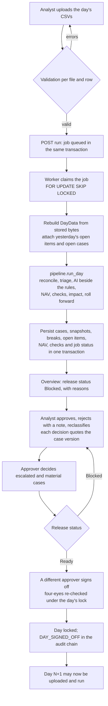

# ReconPilot: technical overview

This is the deep write-up for engineers and technical interviewers: what the
system models, how it is put together, the controls I cared about and how they
are enforced, how I kept the data consistent, how the AI is fenced in, what I
did about security and accessibility, how it is tested, and the trade-offs I
accepted. The [README](../README.md) is the short version.

Every module and test named here exists in the repository; figures come from
[`docs/evaluation.md`](evaluation.md) or from the test suite itself.

## Contents

1. [The problem and the daily workflow](#the-problem-and-the-daily-workflow)
2. [Architecture](#architecture)
3. [How a business day flows](#how-a-business-day-flows)
4. [Controls](#controls)
5. [Data integrity](#data-integrity)
6. [The AI second opinion](#the-ai-second-opinion)
7. [Security](#security)
8. [Front end and design](#front-end-and-design)
9. [Testing](#testing)
10. [Trade-offs and decisions](#trade-offs-and-decisions)
11. [What I would do next](#what-i-would-do-next)

## The problem and the daily workflow

A fund's NAV is struck every business day, and before it goes out an operations
team has to prove that the fund's own books agree with the custodian. That
means three comparisons:

- the **book positions** (what the fund thinks it holds, at what price) against
  the **custodian's holdings statement**;
- the **book's trade settlements and other cash** against the **custodian's
  cash statement**, which arrives with free-text narrative, netted lines,
  missing references and lines value-dated in the future;
- the result against the **NAV**: are the prices fresh, has the NAV moved more
  than expected, have the fees been accrued, does the cash tie out?

Anything that does not agree is a **break**. The job is not only to find
breaks but to work them: group them into cases, decide which matter (by their
effect on the NAV, in basis points), explain each one, chase the custodian,
carry the unresolved ones into tomorrow, escalate the ones that have been open
too long, and finally have someone who did not do the work sign off the day.
The cycle I modelled is:

1. **Load** the day's files (book trades and positions, custodian holdings and
   cash, static data).
2. **Reconcile**: match positions and cash, apply tolerances, raise breaks.
3. **Triage**: group breaks into cases and suggest a cause (missing trade, late
   settlement, price mismatch, stock split, dividend, FX difference,
   unexplained).
4. **Size**: each case's NAV impact in USD and bp, materiality, gross exposure.
5. **Roll forward**: carry yesterday's open cases and unmatched cash in, clear
   what now agrees, age the rest, escalate, check SLAs.
6. **Value and check** the NAV.
7. **Review**: analysts approve, reject or reclassify; approvers take the
   escalated cases.
8. **Sign off** under four-eyes, which releases the NAV and locks the day.

## Architecture

There are two Python packages and a front end. The rule I held to throughout:
**the engine is a library and never imports the web layer.** The command line
and the web application are two callers of the same `pipeline.run_day`.

```
browser ──► front end (Vite in development; built files served by the API in production)
               │ /api  (session cookie, CSRF header on every change)
               ▼
            api (FastAPI) ──────────────┐
               │ enqueue                 │ read/write (as the restricted rp_app role)
               ▼                         ▼
            worker ─────────────────► PostgreSQL
               │ calls
               ▼
            reconpilot engine ── AI provider (server-side key, or a private endpoint)
```

### The engine: `src/reconpilot/`

| Module | Role |
|---|---|
| `generator.py`, `sequence.py` | Synthetic days with planted breaks and an answer key; `sequence` makes consecutive days for one fund, with breaks that persist until a planted fix date |
| `matching.py` | Position matching on quantity and price (tolerance per asset class: equities 25 bp, bonds 10 bp); cash matching in passes, strictest first (exact reference and amount, reference within tolerance, security and amount when the reference is blank, many-to-one for netted lines); `carry_forward` for unmatched items |
| `triage.py` | Groups breaks on the same security into a `Case` and suggests a cause with a confidence, an explanation and a draft custodian query |
| `ai.py` | The optional second opinion: evidence, prompt, provider clients over plain HTTP, guardrails, cache, audit |
| `impact.py` | NAV impact (the change in market value plus the cash difference if the custodian is right), basis points of NAV, gross exposure, materiality and the engine's NAV release check |
| `ledger.py` | Cases across days: `roll_forward` clears, ages (business days, buckets 0-1, 2-5, >5), escalates and checks SLAs, with audit entries |
| `nav.py` | NAV with management-fee and expense accruals (weekends on Mondays), and the release checks: stale and missing prices, NAV movement, cash tie-out, day-on-day price moves, accruals |
| `pipeline.py` | `run_day`: reconcile, triage, AI (if asked), value, check, size, roll forward, sort by impact |
| `review.py` | `ReviewSession`: approve, reject, reclassify, roles, four-eyes sign-off |
| `audit.py` | The SHA-256 hash chain: `record_hash`, `AuditLog.append`, `verify` |
| `report.py`, `mi.py` | The Excel exception report (Summary, Exceptions, Breaks, Cash matching, NAV checks, MI) and the MI with its tidy `mi.csv` |
| `evaluate.py` | Scores detection and cause against the answer key, single-day and multi-day, rules against AI |

`pipeline.run_day` is short enough to quote the order of operations, which
matters: the AI runs after triage but before sizing and the roll-forward, so it
can annotate a case but never alter what is sized, aged or cleared.

```python
recon = reconcile(day, tolerances)
cases = triage(day, recon)
if use_ai:
    assist_cases(day, recon, cases, ai_client, audit=audit, ...)
nav = compute_nav(day)
checks = run_checks(day, nav, recon, **(check_settings or {}))
cases = apply_impacts(day, recon, cases, nav, settings.materiality_bp)
open_cases, cleared = roll_forward(prior_open or [], cases, recon, day.as_of, settings, audit, ...)
```

### The web layer: `src/reconpilot_web/`

- **FastAPI** (`app.py`) with one router per concern: `auth`, `funds`, `days`
  (upload, validation, status, queuing runs), `cases`, `release`, `unlock`,
  `overview`, `daytrail`, `mi`, `auditviewer`, `admin`, `demo`, `preferences`.
  CSRF protection is a global dependency; security headers are a middleware,
  and also set on unhandled 500s, which Starlette answers outside it.
- **SQLAlchemy 2 and Alembic** (`models.py`, `migrations/versions/0001` to
  `0004`). PostgreSQL is the system of record: `funds`, `business_days`,
  `input_files` (the original bytes with their SHA-256), `cases` (current state
  as columns for querying, the engine's full `Case` as JSONB), `case_snapshots`
  (each case as it stood at the end of each day), `breaks`, `open_items`
  (carried cash), `decisions`, `audit_log`, `jobs`, `ai_cache`,
  `unlock_requests`, `users`, `sessions` and `instance_settings`.
- **Embedded PostgreSQL for zero-Docker local work** (`devdb.py`). The
  `pgserver` wheel ships the server binaries; `reconpilot-web dev` starts a
  cluster in `.rp_data/pg`, runs the migrations, and launches the API, an
  in-process worker and Vite. The tests start their own. Production points
  `RP_DATABASE_URL` at any PostgreSQL 15 or later.
- **A Postgres job queue** (`jobs.py`). A run with the AI on can take minutes,
  so every run is a job. `enqueue` writes the job in the caller's transaction,
  so a job exists exactly when the request that asked for it commits. `claim`
  takes the oldest due job with `FOR UPDATE SKIP LOCKED`, so two workers never
  take the same one. The handler's work and the job's `done` status commit in
  one transaction; on failure that transaction rolls back and a fresh one
  re-queues the job with a linear back-off (10 seconds times the attempts so
  far), up to `max_attempts` (three). A job left `running` longer than its
  30-minute lease by a dead worker is recovered as a failed attempt.
- **The worker's run handler** (`runner.py`) does in one transaction what
  `reconpilot run` does with a folder (see [Data integrity](#data-integrity)).

### The front end: `web/`

React 19 and TypeScript on Vite 7, React Router 7, **TanStack Query** for every
API call (the day and the job are polled every two seconds while a run is in
progress, and not otherwise), TanStack Table for the dense tables, Radix UI
primitives for dialogs, menus, popovers and tooltips, and Lucide icons. The
browser holds no figure of its own: every number comes from the API, and the
browser tests check that what is on screen is what the API returned.

## How a business day flows



Every arrow that changes state writes to the audit chain: the upload, the
validation result, the run, each AI call, each automatic clear and escalation,
each decision, the sign-off (or the refused attempt, `SIGN_OFF_BLOCKED`).

## Controls

These were the part I cared about most. Each is enforced on the server and
covered by tests in `tests/web/`; the front end only hides what the server
would refuse anyway.

### Four-eyes sign-off

Only an approver may sign off, and `release.can_sign_off` adds a `FOUR_EYES`
reason for anyone who decided any of the day's open cases, including a
decision later overridden by someone else
(`test_four_eyes_counts_a_decision_later_overridden`). The engine's
`ReviewSession.sign_off` applies the same rule on the command line.

### Sign-off locks the day; days go in order

Sign-off locks the day row, re-checks every condition inside that transaction
and then writes `DAY_SIGNED_OFF`. A signed-off day's files, run and cases can no
longer change. Day N+1 cannot be uploaded or run until day N is signed off,
which means only the latest day can ever be re-run. The upload screen asks the
server (`GET .../intake`) before anyone tries and says in plain words which day
is holding things up.

### Two-person unlock

Occasionally a released day has to be reopened. `unlock.py` makes that take
two people: an administrator asks with a reason (`UNLOCK_REQUESTED`), and a
**different** user with the approver role confirms within 24 hours
(`DAY_UNLOCKED`), or declines with a note; the requester may withdraw, and an
unconfirmed request expires. Only the fund's latest signed-off day qualifies,
and only before the next business day has run (after that, its cases were
carried from this sign-off). Both conditions are checked when asking and again
under the day's lock when confirming. Confirming returns the day to *ready*;
it must be signed off again under four-eyes, and the audit chain keeps the
original sign-off beside the unlock.

### Stale-decision protection

Every decision quotes the `version` of the case it was made against. In
`cases.py` the day is locked first and the case second (the same order the
runner and sign-off use, so there is no deadlock), so two people deciding the
same case at once queue up: the first decision stands and bumps the version,
the second finds its version stale and gets a 409, never silently overwriting
the first. The workbench then names who decided and shows their decision,
keeping the second person's note in case they still want it.

### One release status, with its reasons

`release.py` computes a single status, *ready* or *blocked*, from the day's
live cases and checks, the same for everyone who asks
(`test_release_status_identical_for_every_role`). The reasons are
`NOT_RUN`, `PENDING_DECISIONS`, `MATERIAL_NOT_APPROVED`,
`ESCALATED_NEEDS_APPROVER` and one `CHECK_FAILED` per failed check, plus
`FOUR_EYES` for the person asking. I deliberately did not show the engine's own
"NAV release" check as a separate failure: it covers material cases only, so
next to a broader *Blocked* it would read as a contradiction. It is shown as
"Material cases approved", recomputed from the current cases, and a test
(`test_day_record_never_contradicts_release`) holds the stored day to the live
status.

### Materiality, ageing, SLAs and escalation

A case's NAV impact is what the NAV would move by if the custodian were right
(`impact.py`); materiality is that impact in basis points of NAV against the
fund's threshold (default 1 bp). Material cases block release until approved
or reclassified. Cases age in business days on the fund's own calendar;
material cases and cases older than the escalation threshold (default 5 days)
are escalated with an audit entry and need an approver's decision; cases older
than their SLA (2 days material, 5 otherwise) are reported as breaches. The
escalation records the impact at the time, and the UI labels it "at
escalation" so nobody mistakes it for today's figure.

### The tamper-evident audit log

Each entry carries `seq`, `ts`, `actor`, `role`, `action`, `payload` and the
previous entry's hash; its own hash is `reconpilot.audit.record_hash`, the
SHA-256 of the canonical JSON. Editing, deleting or reordering any entry breaks
the chain from that point. In the web application:

- **One format.** `auditlog.DbAuditLog` has the engine's `append(actor, role,
  action, payload)`, so the engine's review, ledger and AI code write to
  PostgreSQL unchanged, and an exported chain verifies exactly like an
  `audit.jsonl` file. Payloads are hashed in the form JSONB stores them (a
  `CAST(... AS jsonb)` round trip first), so values JSONB rewrites, such as
  `-0.0`, still verify.
- **No forks.** Appends take a transaction-level advisory lock, so two requests
  can never read the same previous hash; an entry rolls back with the work it
  describes (`test_concurrent_appends_keep_chain`,
  `test_rollback_discards_entry`).
- **Append-only in the database, not just in code.** The application connects
  as `rp_app`, which is granted only `SELECT, INSERT` on `audit_log`; a
  statement-level trigger rejects `UPDATE`, `DELETE` and `TRUNCATE` for
  everyone, the owner included (`test_app_role_cannot_update_audit_log`,
  `test_superuser_cannot_update_audit_log_either`).
- **Verification.** `POST /api/audit/verify` recomputes every hash on the
  server and names the first entry that does not fit; the check is itself
  recorded. Each entry's detail view shows the server's check of that one
  entry. The CSV export carries the stored payloads and hashes in chain order,
  so anyone can re-verify an unfiltered export with `record_hash` and no access
  to the database. A test tampers with a row as a superuser (bypassing the
  trigger) and checks that verification catches it.

## Data integrity

### One transaction per run

`runner.run_day_job` writes the stored files to a temporary folder and reads
them with the engine's own `storage.read_day`, exactly as the command line
reads a data folder; attaches the previous business day's open cash items
(with their trades) and open cases from `open_items` and `case_snapshots`;
calls `pipeline.run_day` with the fund's lifecycle and check settings, the
database audit log and, only when the fund has AI switched on, the AI client;
then stores the cases (bumping each version), the day's snapshots, breaks and
open items, the NAV, the checks and the run summary, and marks the day
`ready`. All of it, the audit entries and the job's `done` status included,
commits together or not at all. A failed attempt leaves nothing behind but the
job's error. The one deliberate exception is the AI cache, which commits each
answer at once on a session of its own: an answer that has been paid for is
kept even if the run that asked for it fails and is retried.

### Re-runs

Re-running is allowed only for the fund's latest run day before it is signed
off. Decisions taken on that day are re-applied, through the engine's
`ReviewSession` and as the person who took them, to cases that still exist for
the same security with the same suggested cause. Any other decision is voided
with a `DECISION_VOIDED_BY_RERUN` entry, and a case the new run no longer
raises is withdrawn with `CASE_WITHDRAWN_BY_RERUN`. Nothing disappears without
a trace.

### Carried items across days

Unmatched cash items are fed into the next day's matching, so a late
settlement that arrives today matches yesterday's book item, and the case
clears automatically with an audit entry and is recorded as a late settlement
whatever it looked like on day one. Carried book items keep their original
trade. That was a fix I made after measuring: before it, a carried case lost
the trade it was first diagnosed with, and the AI's accuracy on carried cases
fell to 54/75. After it, 75/75 (see below).

### The command line and the web pipeline agree

The anti-goal I wrote down before building the web layer was "results that
differ from the command line for the same files". `tests/web/test_equivalence.py`
holds it: five consecutive days of hard data (seed 11, four new breaks a day)
go through `reconpilot run`, `review` and `signoff` into a run folder, and
through the API (upload, run with the worker's handler, decide, sign off) into
PostgreSQL. Every day the two must agree on the open cases, the cases cleared,
the NAV, the checks and the audit actions (once web-only entries such as
sign-ins and uploads are set aside); afterwards the MI route must agree with
the engine's MI over the command line's ledgers, the exported Excel report must
hold the same cells, and the exported `mi.csv` must be byte for byte the
command line's.

### Validation before anything runs

`validation.py` reads each file the way `read_day` will and reports per file
and row (with spreadsheet row numbers): required files, exact headers, types,
one `as_of` matching the chosen day, known securities, no duplicate ids,
settlement not before trade date, FX rates present, and limits of 5 MB and
200,000 rows a file. Errors block the run; warnings do not. Excel's byte-order
marks and CRLF line endings are accepted, and the stored bytes stay exactly as
uploaded.

### Demo and real data never meet

`instance_settings.mode` is written once, at the first migration, and
`create_app` refuses to start against a database of the other mode.

## The AI second opinion

### Design: rules first, the AI beside them

The rules always run and always produce a cause. The AI, when it is switched
on, reads the evidence the engine has already gathered and returns a second
opinion: a cause, a confidence, an explanation, investigation steps and a draft
custodian query. Both are kept and shown side by side. The AI never touches a
figure, never raises, merges or closes a case, never ages or clears anything
and never decides: every decision is a person's, through the decision bar.
That is why detection, false alarms, clearing, ageing and SLAs are identical
with and without it in every evaluation.

The evidence (`ai.build_evidence`) is the case's breaks with book and custodian
figures, the security, related trades (including the original trade for
carried items), settled and pending custodian cash lines with their narrative,
pre-computed differences and ratios, and the rules' suggestion. Quantities are
passed as whole numbers where they are whole, so the model quotes "25,900",
not "25900.0".

### Guardrails

1. **Schema.** `validate_response` requires strict JSON matching
   `RESPONSE_SCHEMA` (no extra properties), and the category must be one of the
   engine's `Category` values.
2. **No invented figures.** `unsupported_figures` extracts every number in the
   explanation (ignoring identifiers and dates) and requires each to equal an
   evidence value after rounding to the decimals it was quoted with; small
   counts are allowed and percentages may match fractions. One unsupported
   figure rejects the whole answer.
3. **Disagreement is flagged, not resolved.** When the AI's cause differs from
   the rules', the case carries `"AI disagrees: needs review"`. For carried
   cases the flag is recomputed after the earlier diagnosis is restored, which
   was the second fix behind the carried-case figures: before it, 20
   disagreements went unflagged.
4. **Fallback.** Any error, timeout, invalid answer or missing key leaves the
   rules' output untouched and the run carries on.

### Caching and audit

Every call is written to the audit chain with the provider, the model, the
prompt hash, the raw response and whether the fallback was used. The cache key
(`prompt_hash`) covers the prompt version, provider, model, effort, system and
user prompts, so an answer is only ever reused for exactly the same question
to exactly the same model. The command line caches on disk; the web
application caches in the `ai_cache` table through `aicache.DbResponseCache`,
which has the engine's cache interface, so `assist_cases` uses it unchanged.

### Off by default, with a private endpoint option

In real mode every fund starts with `ai_enabled: false`. An administrator
switches it on per fund (`PUT /api/admin/funds/{code}/ai`), choosing a provider
the server actually has a key or address for, and must acknowledge where the
evidence goes: to a public provider it leaves the firm, to a private endpoint
it goes to the host shown. `AI_SWITCHED_ON` and `AI_SWITCHED_OFF` record who,
the provider and the model. Besides Anthropic, OpenAI and Google (plain HTTP,
no SDKs), `OpenAICompatibleClient` talks to any OpenAI-compatible endpoint,
such as a firm's own Azure OpenAI deployment, configured only from
`OPENAI_COMPATIBLE_*` environment variables and never chosen automatically.
Keys are never stored in the database or sent to the browser.

The demo never calls a provider: `demo_ai_cache.json` holds the real AI's
answers for every question the demo's fixed sequence asks (102, built by
`scripts/build_demo_ai_cache.py` through the web application's own code so the
prompts match exactly), and `CacheOnlyClient` stands in for the provider. A
test fails if a change to the prompts leaves any demo question unanswered.

### Evaluation

From [`docs/evaluation.md`](evaluation.md) (synthetic data, seed 42, medium
effort, prompt version `2026-11-14.1`):

| | Rules only | AI (gpt-6-luna) | AI (gemini-3.8-flash) |
|---|---|---|---|
| Single day, hard: correct cause of 190 detected | 178 (93.7%) | 190 (100.0%) | 190 (100.0%) |
| Answers accepted by the guardrails | n/a | 198/198 | 198/198 |
| Disagreements (AI right / rules right) | n/a | 12 / 0 | 12 / 0 |
| 20 days, hard: cause right on the first day | 178/190 | 189/190 | not run |
| 20 days, hard: cause right at resolution | 157/160 | 160/160 | not run |

Over the 20-day run, 597 of 598 answers passed the guardrails; the one fallback
was an explanation quoting a figure not in the evidence. On an 8-day hard run
(seed 21, `scripts/ai_carried_check.py`) the AI was right on 44/44 new and
75/75 carried cases after the two carried-case fixes, against the rules' 41/44
and 74/75, with all 11 disagreements flagged.

I am careful about what this shows. The rules and the generator were written
together on synthetic data, so the rules are strong by construction (100% on
the standard data set). All 12 single-day gains are late settlements the
custodian did not report as pending, and the prompt's definition of a timing
break covers that case, so part of the gain comes from the definition. On real
statements an unreported trade can genuinely be missing, which is exactly why
disagreement goes to a person.

### Why the rules stay authoritative

Figures that go to clients have to be reproducible to the cent and explainable
to an auditor without reference to a model's weights. A rules engine gives
both; a model gives neither. What the model is good at is the slow, wordy part
of the job: reading narrative text, weighing dates, writing the explanation and
the query. So the model writes, the rules count, and a person decides. The
figure guardrail stops invented numbers; it does not stop wrong reasoning about
correct numbers, and the human review is there for that.

## Security

What is in place (`auth.py`, `security.py`, `app.py`, the migrations):

- **Built-in accounts** with **argon2id** password hashes, rehashed when the
  parameters are raised; a policy of 12 to 256 characters, at least five
  distinct characters and not a common password (also catching a common
  password with a few digits or symbols tacked on). Usernames are
  case-insensitive. Sign-in against an unknown user still runs a hash, so
  timing does not reveal which accounts exist.
- **Lockout**: five consecutive failures lock an account for 15 minutes, during
  which even the right password is refused; all of it is audited.
- **Sessions**: a random 32-byte token in an httpOnly, SameSite=Lax cookie
  (Secure with `RP_COOKIE_SECURE=1`); the database stores only its SHA-256, so
  a copy of the database cannot be used to sign in. Sessions end on sign-out,
  after 30 minutes idle or 12 hours after sign-in. A change of role, admin flag
  or password, or a deactivation, revokes the user's live sessions.
- **CSRF**: each session has a CSRF token in a readable `rp_csrf` cookie, and
  every POST, PUT, PATCH and DELETE must echo it in `X-CSRF-Token`, matching
  both the cookie and the session's own token, compared in constant time.
  Sign-in and starting a demo, which issue the token, accept JSON only, which a
  cross-site form cannot send.
- **Roles** (`require_roles`, `require_admin`) on every route, with a test that
  walks a table of routes for each role (`test_roles_enforced_on_the_server`).
- **Isolation of demo visitors**: a one-click demo user belongs to one fund,
  has no password, and every request it makes is scoped to that fund; any other
  fund, case, job or audit entry answers 404, so a visitor cannot even learn
  that another's fund exists (`test_nothing_is_shared_between_visitors`).
- **Database least privilege**: the application runs as `rp_app`, which can
  change ordinary tables but only insert into and read the audit log, and only
  read the instance mode; migrations run as the owner.
- **Headers**: `Content-Security-Policy: default-src 'self'; frame-ancestors
  'none'`, `X-Content-Type-Options: nosniff`, `Referrer-Policy: same-origin`,
  and `Cache-Control: no-store` on the API. Fonts are self-hosted so the CSP
  needs no third-party origin. The OpenAPI docs UI is switched off.
- **Inputs**: uploads limited in size and rows and parsed defensively; SQL only
  through SQLAlchemy with bound parameters; secrets only from the environment.
- **Demo limits**: starting a demo is limited to five an hour per address and
  live demo funds are capped at 200; visitor funds expire 24 hours after last
  use.

What is **not** done yet is listed honestly under
[What I would do next](#what-i-would-do-next): rate limits beyond the demo,
dependency audit and CI, SSO, per-fund entitlements for real users.

## Front end and design

### Paper, adapted to a dense desktop tool

The look is Paper ([`docs/design/paper-design-system.md`](design/paper-design-system.md)),
a design system I first wrote for a phone app: warm paper by day, a cool
midnight by night, one contrast card per page for the number that matters, and
a blue-to-violet gradient used only as an accent. A phone system does not
transfer to an operations desk unchanged, so I wrote down exactly where
ReconPilot follows it and where it departs
([`docs/design/paper-adaptation.md`](design/paper-adaptation.md)):

- **Midnight is the default theme**, whatever the system prefers; Paper (light)
  is the theme button's choice, applied by `public/theme-init.js` before React
  starts so the page never flashes.
- **One lead card per screen**, full width and first: NAV per share and the
  release status on the overview, the selected case's NAV impact on the
  workbench, the release status and four-eyes on sign-off, the run status on
  upload, the gross open impact on MI, chain integrity on the audit log.
- **Density**: work-queue rows are 44 px rather than Paper's 56 to 64, but
  every target stays at least 44 by 44 px; the primary pill is 44 px on
  desktop. Still one primary per screen: Approve, Sign off, Run, Verify chain.
- **Navigation**: Paper's floating tab bar becomes a glass capsule in the top
  bar, with the current screen under a lens that springs between items; below
  768 px it floats at the foot of the window as Paper intends. On screens other
  than the overview, the NAV strip shrinks to one quiet line.
- **Status words and colours** mapped to the domain: pending and waiting amber;
  approved, signed off, met and intact green; rejected, blocked, breach and a
  broken chain red; reclassified and *AI disagrees* info blue; material,
  escalated and past SLA neutral tags. Every one carries its word.
- **Figures**: Barlow with tabular digits for every number, amounts in USD with
  en-US grouping, signed where the sign means something, basis points as
  `+4.00 bp`, right-aligned and never wrapped; JetBrains Mono for codes.

### Accessibility

I aimed at WCAG 2.2 AA in both themes and made the browser tests hold it there:

- **axe on every screen and state** the journeys reach (sign-in, a missing
  page, each screen with and without data, dialogs, the palette, the demo), in
  Midnight and in Paper, with the WCAG 2.0, 2.1 and 2.2 A and AA rule sets,
  failing on any serious or critical violation (`web/e2e/helpers.ts`). ESLint
  also runs `jsx-a11y`.
- **A keyboard-only journey** (`web/e2e/keyboard.spec.ts`) works a whole
  business day with no mouse click: sign in, load and run, approve, reject with
  a note, reclassify, decide escalated cases as an approver, sign off through
  the confirmation dialog as a second approver, and load and run the next day.
- **200% zoom** (`web/e2e/zoom.spec.ts`): every screen in a 720 by 450 window
  (a 1440 by 900 screen at 200%) with no sideways scrolling, room for the work
  under the sticky bars, and axe still passing.
- **Live regions**: runs starting and finishing and each decision recorded are
  announced through one polite live region that is always in the page
  (`components/Announcer.tsx`); failures are alerts.
- **Focus**: moving to a screen puts focus on its title and names it in the
  tab; dialogs take and hold focus and give it back on close; after sign-off
  focus moves to the result, because the button pressed has gone.
- **Reduced motion**: `motion.ts` and the CSS switch every transition, figure
  tween and count-up off under `prefers-reduced-motion: reduce`.
- Status never by colour alone, semantic tables with captions, labelled
  controls, a skip link, and the day being viewed in a trend picked out by a
  shape as well as colour.

### Keyboard and command palette

`keyboard/KeyboardProvider.tsx` holds a registry of commands that screens
register while they are mounted (`useCommand`), each with an optional key
sequence. That one registry feeds three things: the shortcuts themselves
(`g o`, `g u`, `g q`, `g s`, `g m`, `g l`, `g f` between screens; `j`/`k` and
arrows in the queue; `a`, `r`, `c` to decide; `/` to search), the `?` dialog
(which lists exactly what is registered on the screen in view), and the Ctrl+K
command palette (`shell/CommandPalette.tsx`), which also finds cases by id or
security name, screens, funds and days. Because commands register only when
the person may use them, the palette offers only what the role and the day's
state allow, and the server checks again regardless. Shortcuts never fire while
typing in a field; Ctrl+K works even there.

## Testing

| Suite | What | How to run |
|---|---|---|
| Engine (`tests/`) | 120 tests: matching, triage, impact, ledger, accruals, pricing, sequence, MI, pipeline, controls, AI with a fake client (no network), the compatible client, carried cases | `pytest tests --ignore=tests/web` |
| Web layer (`tests/web/`) | 284 tests against a real embedded PostgreSQL the tests start: roles on every route, demo isolation, sign-off order, four-eyes, materiality, release status, locking, stale decisions, append-only audit and chain verification, concurrent job claiming, validation, administration, unlocking, the schema and migrations, CLI equivalence | `pytest tests/web` |
| Front end (`web/src`) | 24 Vitest and Testing Library files: formatting, vocabulary, motion, components and screens | `npm run typecheck`, `npm run lint`, `npm test -- --run` |
| Browser (`web/e2e`) | 25 Playwright journeys in Chromium against the real API, worker and built front end on a throwaway embedded database, with axe in both themes, the keyboard-only day and 200% zoom | `npx playwright install chromium` once, then `npm run test:e2e` |
| Demo (`web/e2e/demo`) | The two-minute visitor journey on its own demo server; the README screenshots (skipped unless asked) | `npm run test:e2e:demo`; `npm run screenshots` |

`pytest --collect-only` reports 404 Python tests in all. The two tests I would
point a reviewer to first are `tests/web/test_equivalence.py` (the same files
through both pipelines must agree on everything, down to the bytes of
`mi.csv`) and `tests/web/test_jobs.py::test_two_workers_never_claim_the_same_job`.

The browser journeys cover:

- **Accessibility basics**: sign-in (and a failed attempt), a missing page and
  the shortcuts dialog pass axe, and focus follows the person.
- **A business day**: an analyst uploads and runs a day and works the queue;
  an approver decides the escalated case and is kept from signing off by
  four-eyes; a second approver signs off; the next day is loaded with its cases
  carried in; a viewer reads every screen and can act on none.
- **Funds and upload**: an analyst reads every fund's settings, switches fund
  and finds the choice again in a new session, loads a day's files in two goes
  and is told plainly that the next day waits for sign-off.
- **History and audit**: an analyst follows a carried case across days; a
  viewer filters the audit log to one case, checks an entry, verifies the
  chain and exports it.
- **MI**: a viewer reads MI from the server's figures, downloads both exports
  and finds the downloads in the day's audit trail.
- **Keyboard, palette and zoom**: the keyboard-only day, jumping to a case with
  the palette, and every screen at 200% zoom.
- **Administration and unlock**: an administrator manages a user and a fund,
  the new fund's first day is signed off, and a two-person unlock is asked,
  confirmed by a different approver and followed by a fresh sign-off.

`scripts/e2e_server.py` starts the browser-test server: it wipes its data
folder, creates two funds and the four users with a test password, generates
two business days and serves on port 8765 (the demo server on 8766).

### Working a day from a script

Everything the screens do goes through the API, so a day can be worked from a
script too. With files from `reconpilot generate` and the passwords
`reconpilot-web dev` printed:

```python
from pathlib import Path
import httpx

def sign_in(user, password):
    c = httpx.Client(base_url="http://127.0.0.1:8000")
    c.post("/api/auth/login", json={"username": user, "password": password}).raise_for_status()
    c.headers["X-CSRF-Token"] = c.cookies["rp_csrf"]  # required on every change
    return c

analyst, approver, signer = (sign_in(u, "<password>") for u in ("analyst1", "approver1", "approver2"))
fund, day = "DEMO1", "2026-11-09"

files = [("files", (p.name, p.read_bytes(), "text/csv")) for p in Path(f"data/{day}").glob("*.csv")]
analyst.post(f"/api/funds/{fund}/days/{day}/files", files=files)          # validated per file and row
job = analyst.post(f"/api/funds/{fund}/days/{day}/run").json()["job_id"]  # 202: queued for the worker
analyst.get(f"/api/jobs/{job}").json()["status"]                        # 'done' a moment later

for case in analyst.get(f"/api/funds/{fund}/days/{day}/cases").json():  # largest NAV impact first
    who = approver if case["escalated"] else analyst
    who.post(f"/api/funds/{fund}/cases/{case['case_id']}/decision",
             json={"decision": "approve", "version": case["version"]})

signer.get(f"/api/funds/{fund}/days/{day}/release?for_user=me").json()  # ready, reasons, signable_by_me
signer.post(f"/api/funds/{fund}/days/{day}/signoff").json()["status"]   # 'signed_off'
analyst.post("/api/audit/verify").json()                                # {'chain_ok': True, 'broken_at': None, ...}
```

`approver2` signs off because `approver1` decided the escalated cases.

## Trade-offs and decisions

- **The engine as a library, PostgreSQL as the system of record.** I
  considered keeping the command line's run folders as the master copy and
  mirroring them, and letting the engine write to the database itself. The
  first gives two copies of the truth and file races between users; the second
  couples the engine to a database and breaks the command line. A thin
  persistence layer around an untouched engine, plus the equivalence test,
  gave me one truth and two callers.
- **A Postgres job queue rather than a broker.** A table and `SKIP LOCKED`
  give exactly-one claiming, transactional enqueue and a job status that
  commits with the work, with no second piece of infrastructure. The trade-off
  I accepted is polling (one second idle) and throughput I will never need for
  a handful of runs a day.
- **Embedded PostgreSQL instead of Docker or SQLite.** SQLite would have been
  simpler but would not exercise the things I cared about: `SKIP LOCKED`,
  advisory locks, JSONB, roles and grants, triggers. `pgserver` gives a real
  PostgreSQL from `pip install`, on Windows as well, and the tests run against
  the same engine as production.
- **Days strictly in order.** It removes a whole class of problems (a re-run of
  day N changing what day N+1 carried in) at the price of flexibility: a late
  correction needs the two-person unlock, and only for the latest day. For a
  NAV control I think that is the right way round.
- **One global audit chain, not one per fund.** Simpler to verify and
  impossible to fork, at the cost of serialising every append behind one
  advisory lock. At this scale the lock is never the bottleneck.
- **Cases keyed by security.** It makes carrying and clearing straightforward
  and matches how breaks are usually worked, but two unrelated breaks on one
  security share a case, and payments with no security identifier pool
  together, which is the remaining weakness in the evaluation.
- **NAV impact assumes the custodian is right.** If the book is right the
  impact is the same size with the opposite sign, which is why I use it for
  ranking and materiality, not as a correction, and why I always show gross
  beside net.
- **Built-in accounts before SSO**, with a nullable `external_subject` on
  `users` so SSO can be added without reworking roles.
- **Polish after function.** Nothing was styled until a day could be worked
  end to end; the Paper restyle came last and changed markup, not behaviour,
  with the axe and keyboard suites as the guard.

## What I would do next

The web application is a working system, not a deployable product for a
regulated firm. In rough order of priority:

1. **Rate limits** on sign-in, runs and exports per address and per account;
   today sign-in is protected by lockout only, and only starting a demo is
   rate-limited.
2. **CI with a dependency audit**: GitHub Actions running pytest, Vitest, lint,
   typecheck and Playwright on every push, plus `pip-audit` and `npm audit`.
   The suites exist and run locally; the pipeline does not yet.
3. **Single sign-on** (OIDC or SAML) through `users.external_subject`, keeping
   roles in the application.
4. **Per-fund entitlements for real users.** Today any signed-in user can see
   every fund; only demo visitors are scoped to one.
5. **An external anchor for the audit chain.** The application's role cannot
   change the log and the trigger stops the owner by accident, but the
   database's owner could drop the trigger and rewrite the whole chain
   consistently. Publishing the latest hash somewhere outside the database
   (another store, a signed timestamp) would close that.
6. **A hosting kit**: HTTPS, backups and point-in-time recovery, monitoring,
   high availability and log shipping.
7. **Live feeds** in place of CSV uploads: SWIFT MT535 and MT950, ISO 20022
   camt.053.
8. **Domain depth**: per-currency cash accounts, accrued interest on bonds,
   breaks tracked below the security level, and AI extraction of
   corporate-action notices checked against the custodian.
9. **Measure the private endpoint** with `reconpilot evaluate --ai
   --ai-provider openai_compatible` before any fund switches it on, and measure
   analyst time per case with and without the AI's write-up, which is the
   figure that would actually justify it.
